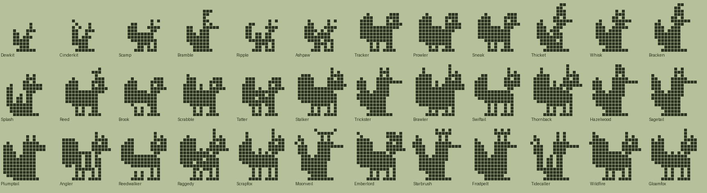
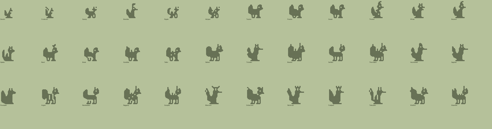

# Fox family (Plus): design

Status: design only. The species data, evolution tree and pixel art exist and validate (`tools/families/fox.py`, `tools/archetypes_fox.py`, `python3 tools/check_family.py fox`). It is **not wired into the app yet**; see "Integration" below. Names and art are original; the fox bodies were built from parts (ellipses, triangles, lines), and nothing is traced from an existing game's creatures.

## Concept
A quiet, curious animal family: foxes growing up in a hedgerow valley. Where the dinos are about raising a creature, the foxes are about character: three ways of living (hunt, forage, fish), a stray line for neglect, and the old folktale payoff that a wise fox grows extra tails. The ultimates carry two, three or five tails, a halo, a crown or a flame tip depending on how the fox was raised.

Tone: gentle and a little mischievous. Same care rules as the dinos, so there is nothing new to learn.

## Same rules, different animals
The fox family uses the existing engine unchanged: five stages, the same 5-minute ticks, the same branch requirements (`mist_min`, `train`, `wins`, `smarts`, `heavy`, `lead`), the same care, Classic and Vacation modes and the same Dex. The family only changes names, art and the food labels.

| Engine food | Dino label | Fox label |
|---|---|---|
| meat | Meat | Mice |
| veggie | Veggies | Berries |
| pasta | Pasta | Fish |

## Lines (they decide the coat colour in Technicolor)
- **Hunter** (mice): rust-red coat. Scamp, Tracker, Prowler, Sneak, Stalker, Trickster, Brawler, Swiftail, Emberlord, Wildfire.
- **Forager** (berries): amber-gold coat. Bramble, Thicket, Whisk, Bracken, Thornback, Hazelwood, Sagetail, Starbrush, Moonveil.
- **Riverside** (fish): silver-blue coat. Ripple, Splash, Reed, Brook, Plumptail, Angler, Reedwalker, Tidecaller, Frostpelt.
- **Stray** (neglect): ash-grey coat. Ashpaw, Scrabble, Tatter, Raggedy, Scrapfox, Gloamfox.
- **Kit** (babies): cream with tan ears.

## Numbers
36 species: 2 kits, 4 children, 11 teens, 12 adults, 7 ultimates. Every species is reachable, every branch list ends in a guaranteed fallback, and no branch is shadowed by an earlier one (`tools/check_family.py`). The requirement values deliberately match the tuned dino thresholds, so the existing balance styles apply unchanged.

## The tree
### Kits
| Species | Line | Look | Becomes (first match wins) |
|---|---|---|---|
| Dewkit | baby | A damp little kit with enormous ears. | Ashpaw (1+ care mistakes); Scamp (mostly mice); Bramble (mostly berries); Ripple (mostly fish) |
| Cinderkit | baby | Born with a warm glow at the tail tip. | Ashpaw (1+ care mistakes); Bramble (mostly berries); Ripple (mostly fish); Scamp (mostly mice) |

### Children
| Species | Line | Look | Becomes (first match wins) |
|---|---|---|---|
| Scamp | hunter | Quick, nosy and always pouncing. | Tatter (4+ care mistakes); Prowler (heavy); Tracker (3+ trainings); Sneak (default) |
| Bramble | forager | Collects berries and leaves in its fur. | Tatter (4+ care mistakes); Thicket (3+ trainings); Whisk (12+ smarts); Bracken (default) |
| Ripple | riverside | Loves the riverbank and a good fish. | Tatter (4+ care mistakes); Splash (heavy); Reed (12+ smarts); Brook (default) |
| Ashpaw | stray | Scruffy and wary, sleeps under porches. | Scrabble (3+ trainings); Tatter (default) |

### Teens
| Species | Line | Look | Becomes (first match wins) |
|---|---|---|---|
| Tracker | hunter | Follows any trail, nose to the ground. | Raggedy (4+ care mistakes); Trickster (20+ smarts); Stalker (default) |
| Prowler | hunter | Heavy-pawed and patient. | Raggedy (4+ care mistakes); Stalker (3+ battle wins); Brawler (default) |
| Sneak | hunter | Light on its feet, hard to spot. | Raggedy (4+ care mistakes); Trickster (20+ smarts); Swiftail (default) |
| Thicket | forager | Burrows into hedges and bramble. | Raggedy (4+ care mistakes); Thornback (default) |
| Whisk | forager | Clever and quick with a trick. | Raggedy (4+ care mistakes); Sagetail (20+ smarts); Hazelwood (default) |
| Bracken | forager | Calm forager in the ferns. | Raggedy (4+ care mistakes); Hazelwood (default) |
| Splash | riverside | Round, wet and cheerful. | Raggedy (4+ care mistakes); Plumptail (default) |
| Reed | riverside | Thoughtful, watches the water. | Raggedy (4+ care mistakes); Angler (2+ battle wins); Reedwalker (default) |
| Brook | riverside | Easygoing river wanderer. | Raggedy (4+ care mistakes); Angler (2+ battle wins); Reedwalker (default) |
| Scrabble | stray | Scrappy digger, always muddy. | Scrapfox (default) |
| Tatter | stray | Patchy coat, tough as nails. | Scrapfox (3+ trainings); Raggedy (default) |

### Adults
| Species | Line | Look | Becomes (first match wins) |
|---|---|---|---|
| Stalker | hunter | A silent hunter of the tall grass. | Moonveil (40+ smarts); Emberlord (default) |
| Trickster | hunter | Outwits everyone, glasses and all. | Starbrush (40+ smarts); Moonveil (default) |
| Brawler | hunter | Broad and strong, wins most scuffles. | Emberlord (5+ battle wins); Frostpelt (default) |
| Swiftail | hunter | The fastest fox in the valley. | Wildfire (default) |
| Thornback | forager | Bristling spines in the bramble. | Starbrush (40+ smarts); Wildfire (default) |
| Hazelwood | forager | Gentle keeper of the woods. | Starbrush (40+ smarts); Wildfire (default) |
| Sagetail | forager | Wise, with a second tail to match. | Starbrush (default) |
| Plumptail | riverside | Round, fluffy and very well fed. | Frostpelt (default) |
| Angler | riverside | Patient river fisher, never misses. | Tidecaller (default) |
| Reedwalker | riverside | Strides through the shallows. | Tidecaller (40+ smarts); Moonveil (default) |
| Raggedy | stray | Ragged but resourceful. | Gloamfox (default) |
| Scrapfox | stray | Dented, scarred and still smiling. | Gloamfox (default) |

### Ultimates
| Species | Line | Look | Becomes (first match wins) |
|---|---|---|---|
| Moonveil | forager | Three silver tails and a quiet halo. | (final form) |
| Emberlord | hunter | A crowned hunter with a flame-tipped tail. | (final form) |
| Starbrush | forager | Five tails sweep the night sky. | (final form) |
| Frostpelt | riverside | Snow-white, serene and plush. | (final form) |
| Tidecaller | riverside | Calls the river with three striped tails. | (final form) |
| Wildfire | hunter | Fast, fierce and trailing sparks. | (final form) |
| Gloamfox | stray | Dusk-dweller with a shadow tail. | (final form) |

## Art direction
- **Silhouette rules.** A fox is read from three things: tall pointed ears, a pointed snout, and a big plume tail. Every body keeps those at every size (ears have a minimum height, the snout a minimum length, legs stay one pixel wide). Small stages are built natively at their own size instead of shrinking the adult, because averaging erases thin features.
- **Archetypes** (`tools/archetypes_fox.py`): `fox_stand` (quadruped, the hunter and riverside bodies), `fox_sit` (upright, the forager bodies), `fox_fennec` (oversized ears, lighter build: the fast, light species), `fox_arctic` (round and fluffy: well-fed species and Frostpelt), `fox_kitsune` (regal and upright: the multi-tailed ultimates).
- **Decorations** reuse the shared set (scarf, leaf, glasses, crown, halo, stripes, spots, belly, spikes, fur, flame tail) plus the new extra tails (`tails2`, `tails3`, `tails5`).
- **Technicolor** (to build): colours follow the line, with two patterns that make foxes read as foxes in colour, a **cream chest and belly** and a **white tail tip**. These need two new layers, `CHEST` and `TAIL_TIP`, tagged by the sprite renderer (the tail tip is the leftmost two columns of the tail, the chest is the front lower body). Proposed body colours: hunter `#C2623A`, forager `#D9A441`, riverside `#8FA3B5`, stray `#9A948C`, kit `#E7DCC0`; chest and tail tip `#F1EDE0`; the arctic bodies use snow `#E9E6DC`. Final values to be tuned by eye, as for the dinos.

## Known weak spots in the art
- In plain ink the teens still read a little like squirrels or cats. Colour (rust coat, cream chest, white tip) is what closes that gap, so judge the art in Technicolor before redrawing.
- The multi-tail fans (Moonveil, Starbrush, Tidecaller) are stringy lines at 16x16. After Scale2x they smooth, but they may want thicker plumes.
- The sitting pose is the weakest silhouette. If it still looks off in colour, make the forager bodies from the standing pose with a different tail and ears.

## Integration (the next step, not done)
1. `tools/gen_swift.py` and `tools/gen_ts.py` read every family module (`dino` from `tools/species.py`, `fox` from `tools/families/fox.py`) and emit one combined species list with `family` set per species and per-family hatchlings.
2. `Species.families` gains `fox` with `isFree: false`, and a per-family food label table drives the feed menu. The balance report and the reachability check run per family.
3. Technicolor gains the family-specific line colours and the two new layers.
4. The "choose your egg" screen (see `docs/PLUS.md`) lists families, with Plus gating through the Entitlements protocol.
5. Dex: per-family counts, with locked families shown as silhouettes.
6. Tests: the family check, a balance run for fox, a render of every fox species, and the Traditional-mode regression for the new sprites.

## Open questions for the owner
- **Name of the family and the first Plus pack.** "Foxes" is a working title; a little character (a collective name such as "the Hedgerow Foxes") could help the store listing.
- **Scope of the launch pack.** All 36 fox species at once, or a smaller first release (kits through adults, ultimates later)?
- **Tone of the multi-tail ultimates.** The kitsune reference is generic folklore, but confirm the tone you want before the store art.
- **Second family.** Rabbit-like or bird-like next, per the Plus plan.
