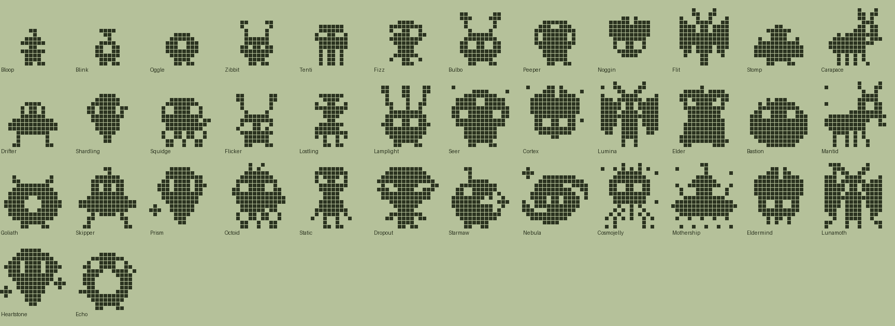
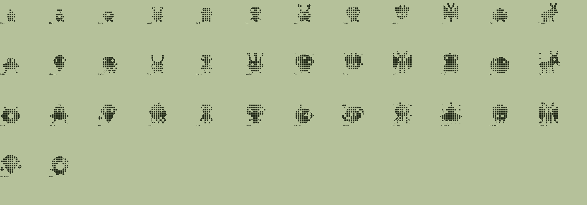

# Alien family (Plus): design

Status: data, pixel art and app integration exist (`tools/families/alien.py`, `tools/archetypes_alien.py`, `python3 tools/check_family.py alien`). This is the twelfth family and the first with its own Technicolor-only biome built for it (`space`). All names and art are original: generic sci-fi tropes only (big dark eyes, antennae, saucers, tentacles, crystals); no existing franchise creature.

## Concept and tone
Cute little aliens for people who grew up on sci-fi and arcade games: grey-green wobblers, antenna blobs, tentacle tots, floating brains, saucer pilots, moth-folk, crystal beings, and cosmic ultimates (a star-eater, a nebula, a cosmic jellyfish, a friendly mothership). Warm, funny, all-ages. A few silhouettes (the ship, the jelly) nod to arcade invaders without copying any one character. Same engine and care rules as every other family.

| Engine food | Dino | Alien |
|---|---|---|
| meat | Meat | Moon cheese |
| veggie | Veggies | Stardust |
| pasta | Pasta | Comet ice |

## Lines (Technicolor body colour)
- **Scout** (Stardust, `#8FB57C`): curious and smart. Zibbit, Bulbo, Peeper, Noggin, Flit, Lamplight, Seer, Cortex, Lumina, Elder, then Eldermind, Lunamoth and the Mothership.
- **Hull** (Moon cheese, `#7D93A8`): heavy and strong. Oggle, Stomp, Carapace, Bastion, Mantid, Goliath, then Starmaw.
- **Void** (Comet ice, `#9A86C4`): cosmic. Tenti, Drifter, Shardling, Squidge, Skipper, Prism, Octoid, then Nebula, Cosmojelly and Heartstone.
- **Stray** (neglect, `#8C908C`): dim, glitchy, lost. Fizz, Flicker, Lostling, Static, Dropout, then Echo.
- **Hatchling** (babies, `#BFDCB6`): Bloop, Blink.

## Numbers
38 species: 2 hatchlings, 4 children, 11 teens, 13 adults, 8 ultimates. Requirements use the dino and cat magnitudes (mist_min 1/4, train 3, wins 2/3/5, smarts 12/20/40, heavy, lead); `disc` is not used. Neglect is reached only by `mist_min` (1 at the hatchling stage, 4 later). Scout and void parents also cross over (Tenti can grow into Peeper on smarts, Skipper can become the Mothership), as the cat tree does.

## The tree
### Hatchlings
| Species | Line | Look | Becomes (first match wins) |
|---|---|---|---|
| Bloop | baby | A tiny grey-green wobbler with big dark eyes. | Fizz (1+ care mistakes); Oggle (mostly Moon cheese); Zibbit (mostly Stardust); Tenti (mostly Comet ice) |
| Blink | baby | A one-eyed orb that blinks like a faraway star. | Fizz (1+ care mistakes); Tenti (mostly Comet ice); Zibbit (mostly Stardust); Oggle (mostly Moon cheese) |

### Children
| Species | Line | Look | Becomes (first match wins) |
|---|---|---|---|
| Oggle | hull | Chunky, one big eye and zero doubts. | Flicker (4+ care mistakes); Stomp (heavy); Carapace (default) |
| Zibbit | scout | Its antennae twitch at every beep in the sky. | Flicker (4+ care mistakes); Bulbo (3+ trainings); Noggin (12+ smarts); Flit (default) |
| Tenti | void | A little dome on little tentacles. Mostly wiggles. | Flicker (4+ care mistakes); Squidge (heavy); Peeper (12+ smarts); Drifter (3+ trainings); Shardling (default) |
| Fizz | stray | Flickers like a bad signal. | Lostling (3+ trainings); Flicker (default) |

### Teens
| Species | Line | Look | Becomes (first match wins) |
|---|---|---|---|
| Bulbo | scout | Glowing antenna tips and endless questions. | Static (4+ care mistakes); Lamplight (3+ trainings); Lumina (default) |
| Peeper | scout | Three eyes. Spots your snacks from three angles. | Static (4+ care mistakes); Elder (20+ smarts); Seer (default) |
| Noggin | scout | A floating brain with a small, friendly face. | Static (4+ care mistakes); Elder (20+ smarts); Cortex (default) |
| Flit | scout | Moth-folk who orbit every lamp. | Static (4+ care mistakes); Lamplight (20+ smarts); Lumina (default) |
| Stomp | hull | Round and heavy. The ground feels every step. | Dropout (4+ care mistakes); Goliath (3+ battle wins); Bastion (default) |
| Carapace | hull | Armoured insect scout with a sense of rhythm. | Dropout (4+ care mistakes); Goliath (2+ battle wins); Mantid (default) |
| Drifter | void | A tiny saucer pilot who got lost on purpose. | Dropout (4+ care mistakes); Skipper (20+ smarts); Prism (default) |
| Shardling | void | A crystal that hums when the moon is out. | Dropout (4+ care mistakes); Prism (default) |
| Squidge | void | Six tentacles, no elbows. | Dropout (4+ care mistakes); Octoid (default) |
| Flicker | stray | Half lit and half forgotten. | Static (3+ trainings); Dropout (default) |
| Lostling | stray | Waits at the window for a ship that never lands. | Dropout (3+ trainings); Static (default) |

### Adults
| Species | Line | Look | Becomes (first match wins) |
|---|---|---|---|
| Lamplight | scout | Its antennae light the way home. | Lunamoth (40+ smarts); Mothership (default) |
| Seer | scout | Three eyes and one very big plan. | Eldermind (40+ smarts); Mothership (default) |
| Cortex | scout | Thinks so hard it floats. | Eldermind (default) |
| Lumina | scout | Moth-folk whose wings glitter like star dust. | Lunamoth (default) |
| Elder | scout | Tall, calm and older than the nearest star. | Eldermind (40+ smarts); Lunamoth (default) |
| Bastion | hull | A big round hull plated in space rock. | Starmaw (default) |
| Mantid | hull | Insect scout with very clever claws. | Starmaw (5+ battle wins); Cosmojelly (default) |
| Goliath | hull | One eye, two horns and a lot of heart. | Starmaw (5+ battle wins); Mothership (default) |
| Skipper | void | Flies a spotless little saucer. | Mothership (40+ smarts); Cosmojelly (default) |
| Prism | void | A crystal that splits the starlight. | Heartstone (40+ smarts); Nebula (default) |
| Octoid | void | Six arms, six snacks. | Cosmojelly (default) |
| Static | stray | Fuzzy, dim and tuned between stations. | Echo (default) |
| Dropout | stray | Fell out of orbit and landed fine. | Echo (default) |

### Ultimates
| Species | Line | Look | Becomes (first match wins) |
|---|---|---|---|
| Starmaw | hull | Eats stars and burps constellations. | (final form) |
| Nebula | void | A swirling cloud with a very kind face. | (final form) |
| Cosmojelly | void | Drifts between galaxies on the solar wind. | (final form) |
| Mothership | scout | A friendly mothership. Everyone is invited aboard. | (final form) |
| Eldermind | scout | The wisest brain in the neighbourhood. | (final form) |
| Lunamoth | scout | Moth-folk with a crescent moon for company. | (final form) |
| Heartstone | void | A crystal giant. Warm to hold. | (final form) |
| Echo | stray | A lost signal that finally found someone. | (final form) |

## Art direction
- One strong feature per species, kept at every stage: slanted almond eyes (wobbler, tall grey, sage), ball-tip antennae, wavy tentacles, a forehead third eye, a lobed brain with a fissure, a saucer disc with landing legs, swept moth wings with feathered antennae (Lunamoth adds long tails), a cut-gem rhombus with orbiting shards, a mantis profile, one giant eye with horns, a crowned bell with ribbons (jelly), a pinwheel galaxy, a round body with a bite and a star, a donut, a stacked saucer with an antenna array.
- Eyes are carved holes (2x2, 3 to 4 px slants, a 12 px giant eye). The shader fills them with an opaque pupil and a catch-light in Technicolor.
- Stray species use the `al_glitch` decoration (rows tear sideways, edge pixels drop out). It never makes an enclosed hole, so it cannot be mistaken for an eye.
- Decorations: `al_glitch`, `al_spark`, `al_stars`, `al_moon`, `al_plates`; the existing `horns2` is reused.
- Sheets: `alien-sheet.png`, `alien-sheet-hires.png`. Technicolor on the space biome, day and night: `expo-prototype/docs/screens/alien-shading-1..4.png`; the scene itself in `biomes-light-4.png` and `biomes-dark.png`.

## Integration (done)
- `tools/familyset.py` ORDER (last); regenerated `Shared/SpeciesData.swift`, `expo-prototype/src/core/speciesData.ts` and `reactionsData.ts`; 19 new reaction kinds in `tools/reactions.py` plus three species lines.
- New `space` biome (see `expo-prototype/docs/BIOMES.md`): six new Technicolor-only layers (`STARFIELD`, `PLANET`, `PLANET_SHADE`, `CRATER`, `CRYSTAL`, `HULL`), a dark sky in every phase (`ALWAYS_DARK`), a ringed planet, a small far moon, lunar hills with pits, a landed saucer with blinking lights, glowing crystals, twinkling stars and a shooting star. Traditional is unchanged (no new cues).
- Shading: accent rule for `alien` (glowing antenna and crystal tips, dark feet, pale trailing tips); aliens may have up to three eyes of up to 64 cells and big eyes get a second sparkle. `test/shading.ts` allows up to 64 fill cells for an alien frame (12 elsewhere).
- Tests that list or count families updated (Expo sim, families, biomes; Swift FamilyTests, PetEngineTests). The Dex and Choose-egg lists are driven by `FAMILIES`, so they show the family with no further change.

## Weak spots
- 16x16 is tight: the brain family (Noggin, Cortex, Eldermind) and the moth family (Flit, Lumina, Lunamoth) differ mainly by size and one decoration. Static and Dropout (both grey stray adults) are close in colour.
- The blink fills only one eye pixel (the anchor), so two-eyed aliens blink with one eye.
- Crystal beings read as gems or shields rather than clusters at 16 px; shading and colour carry the facets.
- Echo's glitch is subtle on a ring, and the glitch on small stray children is easy to miss.
- The pinwheel arms of Nebula are the busiest shape and may look noisy at 16 px.
- Tenti and Squidge (tentacles) read as a dome on stilts at stage 2.

## Open questions
- Should the space biome get a Traditional cue (a tiny planet outline)? It has none, like the garden.
- Should the two hatchlings be more distinct from each other (Bloop is a wobbler, Blink an orb)?
