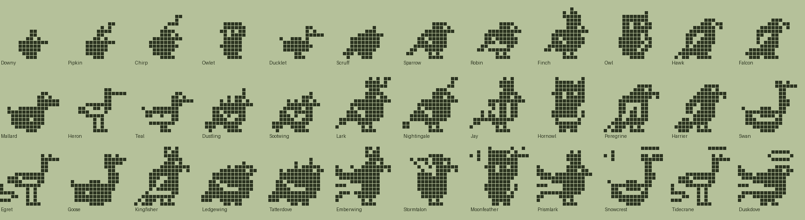
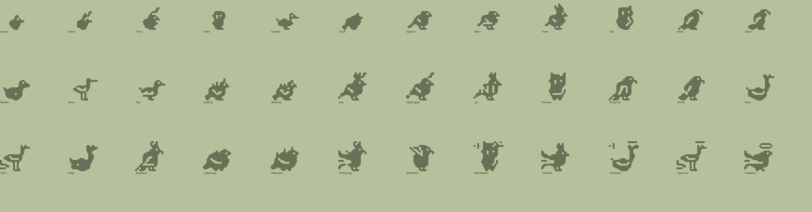

# Bird family (Plus): design

Status: design only. Species data, evolution tree and pixel art exist and validate (`tools/families/bird.py`, `tools/archetypes_bird.py`, `python3 tools/check_family.py bird`). Not wired into the app. Names and art are original; bodies are built from ellipses, triangles and lines.

## Concept
Feathered pets from fluffy chicks to mythic birds. Four ways of growing up: **songbirds** (seeds), **raptors** (worms), **waterfowl** (minnows) and a scruffy **pigeon** stray line for neglect. Ultimates are the folklore payoff: a fire bird, a thunder eagle, a moon owl, a rainbow songbird, a crowned swan, a tide crane and a dusk dove. Tone: cheerful and all-ages.

| Engine food | Dino label | Bird label |
|---|---|---|
| meat | Meat | Worms |
| veggie | Veggies | Seeds |
| pasta | Pasta | Minnows |

(The suggested "Berries" was swapped for "Minnows" so the waterfowl line has a natural food; easy to revert in `FOOD_LABELS`.)

## Lines
- **Raptor** (worms): Owlet, Owl, Hawk, Falcon, Hornowl, Peregrine, Harrier, Emberwing, Stormtalon, Moonfeather.
- **Songbird** (seeds): Chirp, Sparrow, Robin, Finch, Lark, Nightingale, Jay, Prismlark.
- **Waterfowl** (minnows): Ducklet, Mallard, Heron, Teal, Swan, Egret, Goose, Kingfisher, Snowcrest, Tidecrane.
- **Stray pigeons** (neglect, 1+ mistakes as a hatchling or 4+ later): Scruff, Dustling, Sootwing, Ledgewing, Tatterdove, Duskdove.

## Numbers
36 species: 2 hatchlings, 4 chicks, 11 teens, 12 adults, 7 ultimates. Requirement magnitudes match the dino and fox trees. All species reachable, every list has a fallback, no shadowed branch.

## The tree
### Hatchlings
| Species | Line | Look | Becomes (first match wins) |
|---|---|---|---|
| Downy | baby | All fluff and no feathers yet. | Scruff (1+ care mistakes); Owlet (mostly worms); Chirp (mostly seeds); Ducklet (mostly minnows) |
| Pipkin | baby | Peeps at everything, tuft askew. | Scruff (1+ care mistakes); Chirp (mostly seeds); Ducklet (mostly minnows); Owlet (mostly worms) |

### Chicks
| Species | Line | Look | Becomes (first match wins) |
|---|---|---|---|
| Chirp | songbird | Sings before it can fly. | Sootwing (4+ care mistakes); Sparrow (3+ trainings); Robin (12+ smarts); Finch (default) |
| Owlet | raptor | Wide-eyed and wobbly at night. | Sootwing (4+ care mistakes); Owl (heavy); Hawk (3+ trainings); Falcon (default) |
| Ducklet | waterfowl | Waddles to every puddle. | Sootwing (4+ care mistakes); Mallard (heavy); Heron (12+ smarts); Teal (default) |
| Scruff | stray | Grubby and wary, sleeps on ledges. | Dustling (3+ trainings); Sootwing (default) |

### Teens
| Species | Line | Look | Becomes (first match wins) |
|---|---|---|---|
| Sparrow | songbird | Small, brave and always hopping. | Ledgewing (4+ care mistakes); Nightingale (20+ smarts); Lark (default) |
| Robin | songbird | Round red breast, sharp wits. | Ledgewing (4+ care mistakes); Nightingale (20+ smarts); Jay (default) |
| Finch | songbird | A bright little crest and a cheerful trill. | Ledgewing (4+ care mistakes); Jay (2+ battle wins); Lark (default) |
| Owl | raptor | Round, soft and very patient. | Ledgewing (4+ care mistakes); Hornowl (default) |
| Hawk | raptor | Sharp-eyed and strong-winged. | Ledgewing (4+ care mistakes); Peregrine (3+ battle wins); Harrier (default) |
| Falcon | raptor | Streaks across the sky. | Ledgewing (4+ care mistakes); Harrier (3+ battle wins); Peregrine (default) |
| Mallard | waterfowl | Plump, glossy and sure of itself. | Ledgewing (4+ care mistakes); Goose (default) |
| Heron | waterfowl | Stands still in the shallows, thinking. | Ledgewing (4+ care mistakes); Swan (20+ smarts); Egret (default) |
| Teal | waterfowl | Quick little swimmer. | Ledgewing (4+ care mistakes); Kingfisher (2+ battle wins); Goose (default) |
| Dustling | stray | Scrappy pigeon, always dusty. | Tatterdove (default) |
| Sootwing | stray | Patchy feathers, tough as nails. | Tatterdove (3+ trainings); Ledgewing (default) |

### Adults
| Species | Line | Look | Becomes (first match wins) |
|---|---|---|---|
| Lark | songbird | Sings the sun up from a fencepost. | Prismlark (default) |
| Nightingale | songbird | A voice that stops the whole garden. | Moonfeather (40+ smarts); Prismlark (default) |
| Jay | songbird | Bold, loud and rather clever. | Stormtalon (5+ battle wins); Prismlark (default) |
| Hornowl | raptor | Tufted, wise and a little grumpy. | Moonfeather (default) |
| Peregrine | raptor | The fastest bird in the valley. | Stormtalon (5+ battle wins); Emberwing (default) |
| Harrier | raptor | Glides low over the meadow. | Stormtalon (default) |
| Swan | waterfowl | Serene on the water, fierce on land. | Snowcrest (default) |
| Egret | waterfowl | Snow-white, with a lacy plume. | Tidecrane (40+ smarts); Snowcrest (default) |
| Goose | waterfowl | Honks first and asks questions later. | Snowcrest (default) |
| Kingfisher | waterfowl | A blue flash over the stream. | Tidecrane (default) |
| Ledgewing | stray | Ragged but resourceful city bird. | Duskdove (default) |
| Tatterdove | stray | Dented, scruffy and still cooing. | Duskdove (default) |

### Ultimates
| Species | Line | Look | Becomes (first match wins) |
|---|---|---|---|
| Emberwing | raptor | A fire bird that rises from its own embers. | (final form) |
| Stormtalon | raptor | Thunder eagle, wings wide and crackling. | (final form) |
| Moonfeather | raptor | A moon owl with a silver halo. | (final form) |
| Prismlark | songbird | A rainbow songbird with a seven-feather tail. | (final form) |
| Snowcrest | waterfowl | A crowned swan, white as fresh snow. | (final form) |
| Tidecrane | waterfowl | Calls the tide with long, trailing plumes. | (final form) |
| Duskdove | stray | Evening-grey dove with a shadow tail. | (final form) |
## Art direction
- **Silhouette rules.** A bird reads from a round body, a beak (always 2+ px, drawn in raw pixels relative to the head so it never shrinks away), a head crest or tufts, and a tail. Every archetype is built natively at each stage size.
- **Archetypes** (`tools/archetypes_bird.py`): `bird_chick`/`bird_round` (puffballs), `bird_song`/`bird_finch`/`bird_long` (perching songbirds), `bird_owl`/`bird_owl_fat` (upright, ear tufts, big eyes), `bird_raptor`/`bird_hawk` (hooked beak, long tail), `bird_phoenix`/`bird_eagle`/`bird_songfan`/`bird_doveshow` (tail-less bodies for ultimates that draw their own fan or wing), `bird_duck`, `bird_swan`, `bird_heron` (long legs, dagger bill), `bird_pigeon`/`bird_pigeon_fat`.
- **New decorations** (registered in `spritegen.EXTRA_HANDLERS`): `bird_crest` (three swept feathers), `bird_fan` (filled tail fan with feather gaps), `bird_wingspan` (raised spread wing), `bird_note` (music note), `bird_spark` (two sparkles), `bird_streamer` (long trailing plumes). Existing: belly, scarf, halo, crown, stripes, back fur and spikes, tail flame.
- **Technicolor** line colours: raptor `#A67C52`, songbird `#C98A4B`, waterfowl `#7FA0B0`, stray `#9A9A98`, baby `#EBDCA0`. A wing-bar and a beak colour layer (orange beak, dark eye ring) would help in colour; not built.

## Known weak spots
- Raptors (Hawk, Falcon, Harrier, Peregrine) look alike in plain ink; the head and hooked beak are small. Colour and the scarf/stripes carry the difference.
- Stormtalon's spread wing and Emberwing's fan are busy blobs at 16x16; they smooth better at 32x32 but want a hand-drawn pass.
- Songbirds are close cousins (Sparrow/Robin/Finch/Lark/Jay differ mostly by crest and belly).
- Carved wing lines are skipped at the two smallest sizes, so chicks have no wing detail.
- Pigeon strays carry fur/spikes plus fat and read as lumpy; intentional but rough.
- Swan and goose share one silhouette (goose is fat and scarfed).

## Integration (what the app must learn)
1. Register `bird` like fox: `tools/families/bird.py` exposes the same constants; the generators pick it up through `familyset`.
2. Importing `archetypes_bird` (done by `bird.py`) registers six new decorations and 14 archetypes through the spritegen hooks; no app code needed beyond running the generators with the module imported.
3. New food labels (Worms, Seeds, Minnows) via `FOOD_LABELS`; `LINE_COLORS` for Technicolor.
4. Nothing new mechanically. Pigeons are the neglect line via `mist_min`.

## Open questions
- Keep "Minnows" or restore "Berries"?
- Is a pigeon line the right neglect tone for 12+ (it is affectionate, not gross)?
- Hand-polish pass for the raptor heads and the two busiest ultimates?
