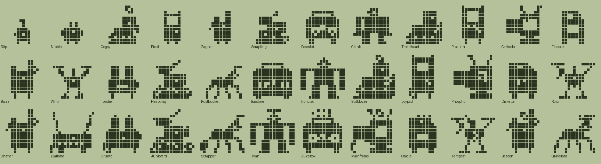
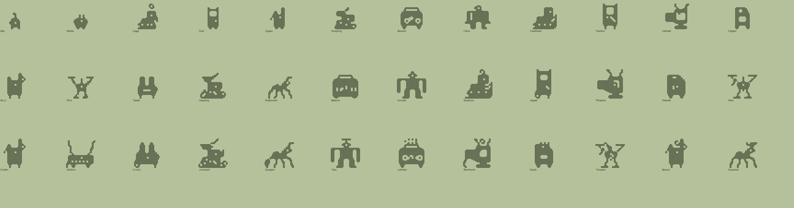

# Bots family (Plus): design

Status: design only. Species data, tree and pixel art exist and validate (`tools/families/bot.py`, `tools/archetypes_bot.py`, `python3 tools/check_family.py bot`). Not wired into the app. All names and art are original.

## Concept and tone
Retro robots and gadgets with millennial nostalgia: boombox, handheld console, CRT monitor, floppy disk, dial-up modem, walkie-talkie, toaster, drone, mech. Friendly and all-ages; no brands or existing characters.

| Engine food | Dino | Bot |
|---|---|---|
| meat | Meat | Oil |
| veggie | Veggies | Chips |
| pasta | Pasta | Batteries |

## Lines (Technicolor body colour)
- **Gear** (Oil, heavy, `#8C7B64`): boombox, mech, tracked dozer. Cogsy, Boomlet, Clank, Treadhead, Bassline, Ironclad, Bulldozer, Titan, Jukebox.
- **Circuit** (Chips, smart, `#6F9A84`): handheld, CRT, floppy. Pixel, Pixelkin, Cathode, Floppet, Joypad, Phosphor, Diskette, Mainframe, Oracle.
- **Spark** (Batteries, energy, `#D4B04C`): walkie, drone, toaster, modem. Zapper, Buzz, Whir, Toastie, Rotor, Chatter, Dialtone, Crumb, Tempest, Beacon.
- **Stray** (neglect, rusty junk, `#9A6A4E`): Scrapling, Heapling, Rustbucket, Junkyard, Scrapper, Gravelord.
- **Baby** (`#C9D2D0`): Blip, Nibble.

## Numbers
36 species: 2 hatchlings, 4 children, 11 teens, 12 adults, 7 ultimates. Dino/fox magnitudes (mist_min 1/4, train 3, wins 2/3/5, smarts 12/20/40, heavy, lead). `disc` is used twice (Diskette and Crumb to their ultimates, 25). Neglect is reached only by `mist_min`.

## The tree
### Hatchlings
| Species | Line | Look | Becomes (first match wins) |
|---|---|---|---|
| Blip | baby | A bulb-topped orb that beeps when happy. | Scrapling (1+ care mistakes); Cogsy (mostly Oil); Pixel (mostly Chips); Zapper (mostly Batteries) |
| Nibble | baby | A little cube with twin antennae and big ideas. | Scrapling (1+ care mistakes); Zapper (mostly Batteries); Pixel (mostly Chips); Cogsy (mostly Oil) |

### Children
| Species | Line | Look | Becomes (first match wins) |
|---|---|---|---|
| Cogsy | gear | Rolls on tiny tracks and loves a good greasing. | Heapling (4+ care mistakes); Treadhead (heavy); Clank (3+ trainings); Boomlet (default) |
| Pixel | circuit | A pocket-sized screen that hums game tunes. | Heapling (4+ care mistakes); Cathode (12+ smarts); Pixelkin (3+ trainings); Floppet (default) |
| Zapper | spark | Crackles with static and chatters nonstop. | Heapling (4+ care mistakes); Whir (3+ trainings); Toastie (heavy); Buzz (default) |
| Scrapling | stray | Cobbled from spare parts and bin finds. | Rustbucket (3+ trainings); Heapling (default) |

### Teens
| Species | Line | Look | Becomes (first match wins) |
|---|---|---|---|
| Boomlet | gear | Carries its own bass. Rattles windows. | Scrapper (4+ care mistakes); Bassline (default) |
| Clank | gear | Upright and sturdy, every step rings. | Scrapper (4+ care mistakes); Ironclad (2+ battle wins); Bassline (default) |
| Treadhead | gear | Squat, strong and slow to stop. | Scrapper (4+ care mistakes); Bulldozer (3+ battle wins); Ironclad (default) |
| Pixelkin | circuit | Has beaten every level twice. | Scrapper (4+ care mistakes); Joypad (default) |
| Cathode | circuit | An old tube that glows when it thinks. | Scrapper (4+ care mistakes); Phosphor (20+ smarts); Joypad (default) |
| Floppet | circuit | Stores everything, forgets nothing. | Scrapper (4+ care mistakes); Diskette (20+ smarts); Phosphor (default) |
| Buzz | spark | Squelches and squawks across the airwaves. | Scrapper (4+ care mistakes); Chatter (20+ smarts); Dialtone (default) |
| Whir | spark | Hovers just above your shoulder. | Scrapper (4+ care mistakes); Rotor (2+ battle wins); Chatter (default) |
| Toastie | spark | Pops up warm and ready at any hour. | Scrapper (4+ care mistakes); Crumb (default) |
| Heapling | stray | A lopsided stack that somehow still walks. | Junkyard (default) |
| Rustbucket | stray | Creaks on spider legs, tough as nails. | Junkyard (3+ trainings); Scrapper (default) |

### Adults
| Species | Line | Look | Becomes (first match wins) |
|---|---|---|---|
| Bassline | gear | A heavy boombox with a thumping heart. | Titan (5+ battle wins); Jukebox (default) |
| Ironclad | gear | A broad mech built like a vault. | Titan (default) |
| Bulldozer | gear | Pushes through anything in its way. | Titan (default) |
| Joypad | circuit | A handheld champion with fast thumbs. | Oracle (40+ smarts); Mainframe (default) |
| Phosphor | circuit | A big old monitor, wise and softly lit. | Mainframe (40+ smarts); Oracle (default) |
| Diskette | circuit | Remembers every file ever saved. | Oracle (25+ discipline); Mainframe (default) |
| Rotor | spark | A quick drone that wins most races. | Tempest (default) |
| Chatter | spark | Always on channel nine. | Beacon (40+ smarts); Tempest (default) |
| Dialtone | spark | Screeches and whistles, then connects. | Beacon (default) |
| Crumb | spark | Warm toast, warm heart. | Beacon (25+ discipline); Tempest (default) |
| Junkyard | stray | A walking heap of stuff nobody wanted. | Gravelord (default) |
| Scrapper | stray | Patched together and proud of it. | Gravelord (default) |

### Ultimates
| Species | Line | Look | Becomes (first match wins) |
|---|---|---|---|
| Titan | gear | A colossal mech with a gleaming crown. | (final form) |
| Jukebox | gear | Plays whatever you needed to hear. | (final form) |
| Mainframe | circuit | A glowing monitor that rules the lab. | (final form) |
| Oracle | circuit | A floppy sage, archives glowing. | (final form) |
| Tempest | spark | A storm drone crackling with power. | (final form) |
| Beacon | spark | A tall transmitter that never loses signal. | (final form) |
| Gravelord | stray | King of the scrapheap, crowned in bolts. | (final form) |

## Art direction
Silhouette is the species: 14 gadget archetypes, each a different shape, built natively per stage size with a rect/hole helper (holes round inward and tiny ones drop out at small stages). Boombox = wide box + carry handle; handheld = tall portrait slab; CRT = tapered tube back + rabbit ears; floppy = notched square; modem = wide slab + two antennas; walkie = slim body + stub antenna; toaster = box + two toast ears; drone = rotor bars + skids; mech = upright with gaps; dozer = tracks + blade; quad = spider legs; junk = lopsided crates; orb and cube for hatchlings. New decorations: `bot_rabbit`, `bot_cog`, `bot_rust`, `bot_zap`, `bot_dish`, `bot_bolts`, `bot_cable`, `bot_tape`.

## Weak spots
- Floppy line (Floppet, Diskette, Oracle) is a fairly plain rounded block; the corner notch is hard to see at 16x16.
- Treadhead and Bulldozer read as a lumpy wedge; Crumb (toaster) is a blob with ear-like toast.
- Whir, Rotor and Tempest are the same drone shape (differ by zap/bolt only).
- Stage-2 children (Zapper, Cogsy, Scrapling) are small and soft; the walkie in particular is a thin lump.
- Clank/Ironclad/Titan share one mech shape (wide variant for adults).
- Pixel/Pixelkin/Joypad share one handheld shape.

## Integration notes
Needs the `bot_*` decorations in `archetypes_bot.py` (registered on import). Uses existing `glasses`, `crown`, `halo`, `bolt`, `antenna`. Foods: Oil, Chips, Batteries. No new mechanic.

## Open questions
Should the neglect line look "broken" (more holes, missing parts) rather than "junk"? A distinct drone silhouette for the Tempest ultimate?
