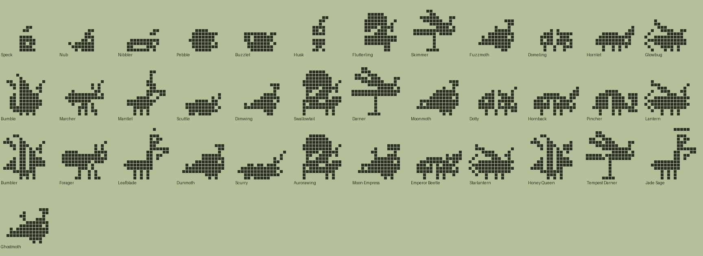
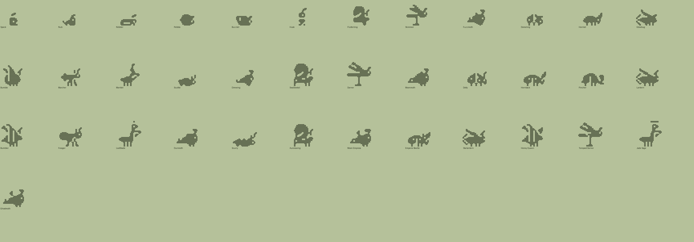

# Bug family (Plus): design

Status: design only. Species data, tree and pixel art exist and validate (`tools/families/bug.py`, `tools/archetypes_bug.py`, `python3 tools/check_family.py bug` prints OK). Not wired into the app. All names and art are original.

## Concept and tone
Metamorphosis suits the engine: egg, then grub or caterpillar, then cocoon, then teen and adult flyers, beetles, bees and ants, then mythic forms. Cute, never creepy: round heads, big feelers, polite roaches.

| Engine food | Dino | Bug |
|---|---|---|
| meat | Meat | Honey |
| veggie | Veggies | Leaves |
| pasta | Pasta | Nectar |

## Lines (Technicolor body colour)
- **Wing** (Nectar, `#A9B4CF`): caterpillar to butterflies, moths, dragonflies.
- **Shell** (Leaves, `#8FA66E`): pill bug to ladybug, horned and stag beetles, fireflies.
- **Hive** (Honey, `#D9B552`): grub to bees, ants, mantis.
- **Stray** (neglect, `#9A8F82`): cocoon, roach, dull moths, ending in the Ghostmoth.
- **Baby** (`#E6DFC8`): Speck, Nub.

## Numbers
37 species: 2 hatchlings, 4 children, 11 teens, 12 adults, 8 ultimates. Requirements use dino/fox magnitudes; `disc` is unused. Neglect is reached by `mist_min` (1 at hatchling, 4 later; Husk also by default).

## The tree
### Hatchlings
| Species | Line | Look | Becomes (first match wins) |
|---|---|---|---|
| Speck | baby | A cracked egg with two curious feelers. | Husk (1+ care mistakes); Buzzlet (mostly meat); Pebble (mostly veggie); Nibbler (mostly pasta) |
| Nub | baby | All head, very little bug. Loves everything. | Husk (1+ care mistakes); Nibbler (mostly pasta); Pebble (mostly veggie); Buzzlet (mostly meat) |

### Children
| Species | Line | Look | Becomes (first match wins) |
|---|---|---|---|
| Nibbler | wing | A caterpillar who eats the whole leaf, then the next. | Dimwing (4+ care mistakes); Skimmer (3+ trainings); Fuzzmoth (12+ smarts); Flutterling (default) |
| Pebble | shell | Rolls up into a ball when shy. | Scuttle (4+ care mistakes); Hornlet (heavy); Glowbug (12+ smarts); Domeling (default) |
| Buzzlet | hive | A plump grub dreaming of honeycomb. | Scuttle (4+ care mistakes); Bumble (heavy); Mantlet (3+ trainings); Marcher (default) |
| Husk | stray | A lonely cocoon on a bare twig. | Scuttle (3+ trainings); Dimwing (default) |

### Teens
| Species | Line | Look | Becomes (first match wins) |
|---|---|---|---|
| Flutterling | wing | Newly unfolded wings, still wobbly. | Dunmoth (4+ care mistakes); Moonmoth (20+ smarts); Swallowtail (default) |
| Skimmer | wing | Races across the pond, never wet. | Dunmoth (4+ care mistakes); Darner (3+ battle wins); Swallowtail (default) |
| Fuzzmoth | wing | Soft as a mitten and drawn to lamps. | Dunmoth (4+ care mistakes); Moonmoth (default) |
| Domeling | shell | A little red shell with polka dots. | Scurry (4+ care mistakes); Pincher (3+ battle wins); Dotty (default) |
| Hornlet | shell | Charges headfirst at anything. | Scurry (4+ care mistakes); Pincher (3+ battle wins); Hornback (default) |
| Glowbug | shell | Flicks on a tiny lamp at dusk. | Scurry (4+ care mistakes); Lantern (default) |
| Bumble | hive | Round, fuzzy and bad at turning corners. | Scurry (4+ care mistakes); Forager (2+ battle wins); Bumbler (default) |
| Marcher | hive | Carries three times its weight, politely. | Scurry (4+ care mistakes); Bumbler (20+ smarts); Forager (default) |
| Mantlet | hive | Folds its arms and judges you kindly. | Scurry (4+ care mistakes); Leafblade (default) |
| Scuttle | stray | Whiskery night wanderer, secretly sweet. | Dunmoth (20+ smarts); Scurry (default) |
| Dimwing | stray | A dusty moth with a nibbled wing. | Dunmoth (default) |

### Adults
| Species | Line | Look | Becomes (first match wins) |
|---|---|---|---|
| Swallowtail | wing | Tall sails, tailed wings and a fine eyespot. | Aurorawing (default) |
| Darner | wing | A long blue dragonfly that hovers on a reed. | Tempest Darner (5+ battle wins); Aurorawing (default) |
| Moonmoth | wing | Pale wings that glow under the moon. | Moon Empress (default) |
| Dotty | shell | Seven spots, all lucky. | Starlantern (40+ smarts); Emperor Beetle (default) |
| Hornback | shell | A great horned beetle, gentle as a sofa. | Emperor Beetle (default) |
| Pincher | shell | Big mandibles, bigger heart. | Emperor Beetle (default) |
| Lantern | shell | Lights the garden path. | Starlantern (default) |
| Bumbler | hive | A honeybee with a very full basket. | Honey Queen (default) |
| Forager | hive | Leads the long line home. | Jade Sage (5+ battle wins); Honey Queen (default) |
| Leafblade | hive | A mantis the colour of the hedge. | Jade Sage (default) |
| Dunmoth | stray | Dusty, dim and very soft. | Ghostmoth (default) |
| Scurry | stray | A big roach with a bigger appetite. | Ghostmoth (default) |

### Ultimates
| Species | Line | Look | Becomes (first match wins) |
|---|---|---|---|
| Aurorawing | wing | A dawn-coloured butterfly trailing sparkles. | (final form) |
| Moon Empress | wing | Silk-winged moth under a crescent moon. | (final form) |
| Emperor Beetle | shell | Armoured, crowned and unfailingly polite. | (final form) |
| Starlantern | shell | Its glow can be seen across the valley. | (final form) |
| Honey Queen | hive | Rules the hive with a crown and a hum. | (final form) |
| Tempest Darner | wing | A dragonfly that rides the storm front. | (final form) |
| Jade Sage | hive | A mantis who meditates among the leaves. | (final form) |
| Ghostmoth | stray | A pale, quiet moth that glimmers like frost. | (final form) |

## Art direction
Silhouette by body plan: low segmented sausage (caterpillar, grub), upright cocoon, tall wing sail (butterfly), swept delta wing (moth), low dome (ladybug, beetles, horn or mandibles), long body on a reed with four wings (dragonfly), tall mantis with folded arms, fat bee with raised wings, three beads on tall legs (ant), flat roach with whips. Built natively at sizes 0.62/0.7/0.86/1/1. New decorations (`EXTRA_HANDLERS`): `bug_glow`, `bug_sparkle`, `bug_dots`, `bug_ring`, `bug_tatter`, `bug_fuzz`, `bug_bands`, `bug_moon`, `bug_crown`; existing `bolt` and `halo` reused.

## Weak spots
- Butterfly/Swallowtail reads like an armchair or a blob; the wing sail needs hand pixel work.
- Moths (Fuzzmoth, Moonmoth, Dunmoth, Ghostmoth) share one silhouette that looks somewhat like a seal; they differ only by decoration.
- Dome beetles are low (5-7 rows); Domeling and Dotty fragment under the carved dots, and Hornback/Hornlet/Pincher resemble small dinosaurs more than beetles.
- Bumble/Bumbler/Queen and Skimmer/Darner/Tempest are near-duplicates within their group.
- Speck, Husk and Pebble are tiny at stage 1-2; Husk is nearly unreadable.
- Antennae are 2 px; ants and roaches read best.

## Integration notes
1. Load `tools/families/bug.py`; it imports `archetypes_bug` which registers archetypes and decorations.
2. Labels Honey/Leaves/Nectar; colours from `LINE_COLORS`.
3. Swift/TS generators must emit the `bug_*` decorations or bake rows. Babies use `arch` (egg, nub) rather than the shared hatchling.

## Open questions
Is a roach line acceptable for all ages? Should the cocoon (Husk) be a stray-only stage?
