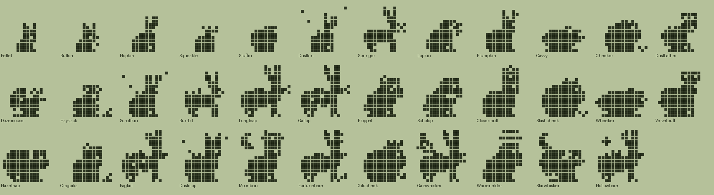
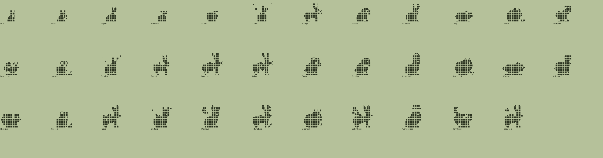

# Bunny family (Plus): design

Status: design only. Species data, tree and pixel art exist and validate (`tools/families/bunny.py`, `tools/archetypes_bunny.py`, `python3 tools/check_family.py bunny`). Not wired into the app. All names and art are original.

## Concept and tone
Rabbits, hares, lops and their small furry cousins, from a meadow to a warren to the moon. Gentle, funny, all-ages.

| Engine food | Dino | Bunny |
|---|---|---|
| meat | Meat | Carrots |
| veggie | Veggies | Clover |
| pasta | Pasta | Seeds |

## Lines (Technicolor body colour)
- **Meadow** (Carrots, `#B49A72`): rabbits, hares, lops. Hopkin, Springer, Lopkin, Plumpkin, Longleap, Gallop, Floppet, Scholop, Clovermuff, then Fortunehare, Galewhisker, Warrenelder.
- **Burrow** (Seeds, `#D2A55E`): hamsters, guinea pigs, chinchillas. Stuffin, Cavvy, Cheeker, Dustbather, Stashcheek, Wheeker, Velvetpuff, Gildcheek.
- **Moon** (Clover, `#C9CFD8`): pikas, dormice, the moon rabbit. Squeakle, Dozemouse, Haystack, Hazelnap, Cragpika, Moonbun, Starwhisker.
- **Stray** (neglect, `#8D8780`): scruffy dust bunnies. Dustkin, Scruffkin, Burrbit, Ragtail, Dustmop, Hollowhare.
- **Baby** (`#EFE4D0`): Pellet, Button.

## Numbers
35 species: 2 hatchlings, 4 children, 10 teens, 12 adults, 7 ultimates. Requirements use dino/fox magnitudes (mist_min 1/4, train 3, wins 3/5, smarts 12/20/40, heavy, lead); `disc` unused. Neglect is reached by `mist_min` only.

## The tree
### Hatchlings
| Species | Line | Look | Becomes (first match wins) |
|---|---|---|---|
| Pellet | baby | A tiny bundle with enormous eyes. | Dustkin (1+ care mistakes); Hopkin (mostly carrots); Squeakle (mostly clover); Stuffin (mostly seeds) |
| Button | baby | Wiggles its nose at everything. | Dustkin (1+ care mistakes); Stuffin (mostly seeds); Squeakle (mostly clover); Hopkin (mostly carrots) |

### Children
| Species | Line | Look | Becomes (first match wins) |
|---|---|---|---|
| Hopkin | meadow | Practising hops, mostly sideways. | Scruffkin (4+ care mistakes); Plumpkin (heavy); Springer (3+ trainings); Lopkin (default) |
| Squeakle | moon | A tiny pika who shouts at clouds. | Scruffkin (4+ care mistakes); Haystack (12+ smarts); Dozemouse (default) |
| Stuffin | burrow | Cheeks full. Always full. | Scruffkin (4+ care mistakes); Cheeker (heavy); Dustbather (12+ smarts); Cavvy (default) |
| Dustkin | stray | A scruffy dust bunny under the sofa. | Burrbit (3+ trainings); Scruffkin (default) |

### Teens
| Species | Line | Look | Becomes (first match wins) |
|---|---|---|---|
| Springer | meadow | All legs and ears. Bounces off walls. | Ragtail (4+ care mistakes); Gallop (3+ battle wins); Longleap (default) |
| Lopkin | meadow | Ears hang down; hears everything anyway. | Ragtail (4+ care mistakes); Scholop (20+ smarts); Floppet (default) |
| Plumpkin | meadow | Round, soft and very good at lounging. | Dustmop (4+ care mistakes); Clovermuff (default) |
| Cavvy | burrow | A guinea pig who squeaks for breakfast. | Dustmop (4+ care mistakes); Wheeker (default) |
| Cheeker | burrow | Hoards seeds in its enormous cheeks. | Dustmop (4+ care mistakes); Stashcheek (default) |
| Dustbather | burrow | Rolls in dust and comes out silky. | Dustmop (4+ care mistakes); Velvetpuff (default) |
| Dozemouse | moon | Sleeps through most of the year. | Dustmop (4+ care mistakes); Hazelnap (default) |
| Haystack | moon | A pika who stacks hay for winter. | Ragtail (4+ care mistakes); Cragpika (default) |
| Scruffkin | stray | Patchy coat and a bit of a grudge. | Dustmop (default) |
| Burrbit | stray | Burrs in the fur, digs everywhere. | Ragtail (default) |

### Adults
| Species | Line | Look | Becomes (first match wins) |
|---|---|---|---|
| Longleap | meadow | A hare who clears fences for fun. | Fortunehare (40+ smarts); Galewhisker (default) |
| Gallop | meadow | Spotted racer. Nobody has caught it. | Galewhisker (default) |
| Floppet | meadow | A big gentle lop with a daisy. | Warrenelder (40+ smarts); Fortunehare (default) |
| Scholop | meadow | Spectacled lop who reads in the garden. | Moonbun (40+ smarts); Warrenelder (default) |
| Clovermuff | meadow | Round and content, smells of clover. | Warrenelder (default) |
| Stashcheek | burrow | Cheeks like sacks, pantry like a vault. | Gildcheek (5+ battle wins); Warrenelder (default) |
| Wheeker | burrow | Wheeks loudly. Wears a tiny scarf. | Starwhisker (40+ smarts); Gildcheek (default) |
| Velvetpuff | burrow | The softest coat in the warren. | Moonbun (40+ smarts); Starwhisker (default) |
| Hazelnap | moon | Curls up in a hazel bush and dreams. | Starwhisker (default) |
| Cragpika | moon | Hay-pile king of the rocky slope. | Moonbun (40+ smarts); Starwhisker (default) |
| Ragtail | stray | Ragged hare, tough as boot leather. | Hollowhare (default) |
| Dustmop | stray | A walking dust bunny. Sneezes a lot. | Hollowhare (default) |

### Ultimates
| Species | Line | Look | Becomes (first match wins) |
|---|---|---|---|
| Moonbun | moon | The moon rabbit, pounding rice under a crescent. | (final form) |
| Fortunehare | meadow | A lucky hare. Four-leaf clovers follow it. | (final form) |
| Gildcheek | burrow | Golden hamster king with a crown of seeds. | (final form) |
| Galewhisker | meadow | A hare so fast it grows wings. | (final form) |
| Warrenelder | meadow | Ancient lop, keeper of the warren. | (final form) |
| Starwhisker | moon | Dormouse of the night sky; tail full of stars. | (final form) |
| Hollowhare | stray | A ghost-grey hare who lives in the hedge. | (final form) |

## Art direction
- **Silhouette per species.** Rabbit: two tall 2 px ears plus a cotton-ball tail. Lop: ears hang out in front of and behind the head. Hare: long low body, big haunch, long legs, long swept-back ears. Hamster: a near-perfect ball with cheek bulge and no tail. Guinea pig: a low long loaf, no tail. Chinchilla: big ring ears and a long tail curling up. Dormouse: low body under a huge arched tail. Pika: tiny egg with wide round ears.
- **Archetypes** (native per stage, 0.58/0.7/0.86/1/1): `bun_sit`, `bun_plump`, `bun_lop`, `bun_hare`, `bun_hare2`, `bun_ham`, `bun_hamfat`, `bun_pig`, `bun_pigfl`, `bun_chin`, `bun_chinfl`, `bun_dor`, `bun_dorfl`, `bun_pika`, `bun_baby`.
- **New decorations**: `bun_clover`, `bun_moon`, `bun_carrot` (unused so far), `bun_seed`, `bun_hay`, `bun_notch`, `bun_dust`, `bun_spark`, `bun_coin`, `bun_whisk`, `bun_bow`, `bun_flower`. Reused: halo, crown, glasses, scarf, spots, wings, fur/spikes back.

## Weak spots
- Lops are the weakest read: the hanging ears are small flaps at head level; Lopkin, Floppet, Scholop and Warrenelder share a body and differ only by glasses, daisy or halo.
- Several hares (Springer, Gallop, Ragtail, Hollowhare, Longleap, Galewhisker) share one body; ears, spots, fur and wings carry the difference. The hare ears look a little antler-like.
- Rabbit adults (Clovermuff, Dustmop, Moonbun) share a body; Plumpkin and Clovermuff are tall and narrow.
- Chinchilla, Dozemouse and Hazelnap are blobby at 16x16; the dormouse tail reads as a bump on the back.
- Cheeker, Stashcheek and Gildcheek are the same ball; seeds and crown differ. Cavvy and Wheeker are low loaves and the scarf is hard to see.
- Floating decorations (moon, clover, sparks) are 1 to 2 px.

## Integration notes
1. Load `tools/families/bunny.py` like cat; it imports `archetypes_bunny`, registering archetypes and `bun_*` decorations.
2. Food labels Carrots/Clover/Seeds; line colours from `LINE_COLORS`.
3. Swift/TS generators must emit `bun_*` decoration names or bake rows.
4. Family picker, Plus gating and Dex counts as for cat.

## Open questions
- Is the Moonbun (moon rabbit) reference acceptable as generic folklore?
- Should lops get a distinct body (shorter, rounder) instead of sharing the rabbit body?
