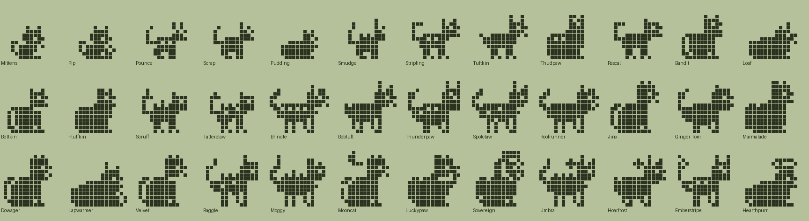
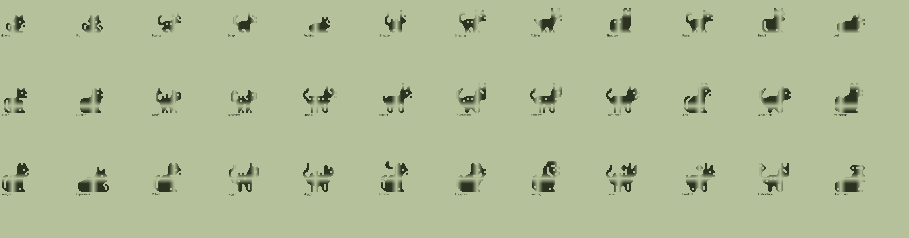

# Cat family (Plus): design

Status: design only. Species data, tree and pixel art exist and validate (`tools/families/cat.py`, `tools/archetypes_cat.py`, `python3 tools/check_family.py cat`). Not wired into the app. All names and art are original.

## Concept and tone
Cosy domestic cats: kittens grow into house cats and legendary felines. Warm, funny, all-ages. Same engine and care rules as dinos and foxes; only names, art and food labels change.

| Engine food | Dino | Cat |
|---|---|---|
| meat | Meat | Tuna |
| veggie | Veggies | Catnip |
| pasta | Pasta | Milk |

## Lines (Technicolor body colour)
- **Hunter / wildcat** (Tuna, `#A8885C`): tabby stripes, lynx tufts, bob tails. Pounce, Stripling, Tuftkin, Thudpaw, Brindle, Bobtuft, Thunderpaw, Spotclaw, then Hoarfrost, Emberstripe, Sovereign.
- **Alley** (Catnip, `#D08A4A`): street smart, ginger. Scrap, Rascal, Bandit, Roofrunner, Jinx, Ginger Tom, Luckypaw.
- **Sofa** (Milk, `#D9CBB0`): round and lazy. Pudding, Loaf, Bellkin, Fluffkin, Marmalade, Dowager, Lapwarmer, Velvet, Mooncat, Hearthpurr.
- **Stray** (neglect, `#8E8A84`): Smudge, Scruff, Tatterclaw, Raggle, Moggy, Umbra (shadow panther).
- **Kitten** (babies, `#EADFC8`): Mittens, Pip.

## Numbers
36 species: 2 kittens, 4 children, 10 teens, 13 adults, 7 ultimates. Requirements use the dino and fox magnitudes (mist_min 1/4, train 3, wins 2/3/5, smarts 12/20/40, heavy, lead); `disc` is not used. Neglect is reached only by `mist_min` (1 at the kitten stage, 4 later).

## The tree
### Kittens
| Species | Line | Look | Becomes (first match wins) |
|---|---|---|---|
| Mittens | baby | A tiny kitten with four white socks. | Smudge (1+ care mistakes); Pounce (mostly meat); Scrap (mostly veggie); Pudding (mostly pasta) |
| Pip | baby | Chases its own tail and wins. | Smudge (1+ care mistakes); Pudding (mostly pasta); Scrap (mostly veggie); Pounce (mostly meat) |

### Children
| Species | Line | Look | Becomes (first match wins) |
|---|---|---|---|
| Pounce | hunter | Springs at every shadow and dust bunny. | Tatterclaw (4+ care mistakes); Thudpaw (heavy); Stripling (3+ trainings); Tuftkin (default) |
| Scrap | alley | Street-smart kitten with a cheeky grin. | Tatterclaw (4+ care mistakes); Rascal (3+ trainings); Bandit (default) |
| Pudding | sofa | Round, warm and always sleepy. | Tatterclaw (4+ care mistakes); Loaf (heavy); Bellkin (12+ smarts); Fluffkin (default) |
| Smudge | stray | A scruffy kitten who hides under porches. | Scruff (3+ trainings); Tatterclaw (default) |

### Teens
| Species | Line | Look | Becomes (first match wins) |
|---|---|---|---|
| Stripling | hunter | Tabby stripes and boundless energy. | Raggle (4+ care mistakes); Spotclaw (3+ battle wins); Brindle (default) |
| Tuftkin | hunter | Tufted ears, a keen eye and a short tail. | Raggle (4+ care mistakes); Bobtuft (20+ smarts); Spotclaw (default) |
| Thudpaw | hunter | Heavy-footed. The floor knows when it lands. | Raggle (4+ care mistakes); Brindle (3+ battle wins); Thunderpaw (default) |
| Rascal | alley | Knocks things off shelves on purpose. | Raggle (4+ care mistakes); Ginger Tom (2+ battle wins); Roofrunner (default) |
| Bandit | alley | Masked and quick, steals socks. | Raggle (4+ care mistakes); Jinx (20+ smarts); Roofrunner (default) |
| Loaf | sofa | Tucks all four paws away and becomes bread. | Raggle (4+ care mistakes); Lapwarmer (default) |
| Bellkin | sofa | Collar bell jingling, never quite sneaks. | Raggle (4+ care mistakes); Dowager (20+ smarts); Velvet (default) |
| Fluffkin | sofa | Fur by the armful. Mind the sofa. | Raggle (4+ care mistakes); Marmalade (default) |
| Scruff | stray | Digs, climbs and tumbles through bins. | Moggy (default) |
| Tatterclaw | stray | Patchy coat, torn ear, tough as nails. | Moggy (3+ trainings); Raggle (default) |

### Adults
| Species | Line | Look | Becomes (first match wins) |
|---|---|---|---|
| Brindle | hunter | Handsome tabby, fast and graceful. | Hoarfrost (40+ smarts); Emberstripe (default) |
| Bobtuft | hunter | A lynx-eared hunter with a bobbed tail. | Mooncat (40+ smarts); Hoarfrost (default) |
| Thunderpaw | hunter | Broad and strong, wins most scuffles. | Sovereign (5+ battle wins); Emberstripe (default) |
| Spotclaw | hunter | Spotted wildcat, lean as a whip. | Emberstripe (default) |
| Roofrunner | alley | King of the rooftops and fences. | Luckypaw (40+ smarts); Umbra (default) |
| Jinx | alley | Outwits everyone, glasses and all. | Mooncat (40+ smarts); Luckypaw (default) |
| Ginger Tom | alley | Scarred champion of the back alley. | Sovereign (5+ battle wins); Umbra (default) |
| Marmalade | sofa | Orange, round and very well fed. | Hearthpurr (default) |
| Dowager | sofa | Wise old puss with pearls and spectacles. | Mooncat (40+ smarts); Hearthpurr (default) |
| Lapwarmer | sofa | Purrs on request. Moves rarely. | Hearthpurr (default) |
| Velvet | sofa | Elegant and slender, with a collar bell. | Luckypaw (40+ smarts); Mooncat (default) |
| Raggle | stray | Ragged but resourceful. | Umbra (default) |
| Moggy | stray | Dented, scarred and still purring. | Umbra (default) |

### Ultimates
| Species | Line | Look | Becomes (first match wins) |
|---|---|---|---|
| Mooncat | sofa | Silver fur and a crescent moon overhead. | (final form) |
| Luckypaw | alley | Waves a lucky paw. Good fortune follows. | (final form) |
| Sovereign | hunter | Lion-maned monarch of the sunny wall. | (final form) |
| Umbra | stray | A shadow panther, quiet as dusk. | (final form) |
| Hoarfrost | hunter | A snow lynx wrapped in frosty fluff. | (final form) |
| Emberstripe | hunter | Striped and fiery, with a glowing tail. | (final form) |
| Hearthpurr | sofa | The warmest cat. Everyone gathers round. | (final form) |

## Art direction
- **Cat vs fox.** Cat = round head, two short WIDE ears (about 2 px tall, 3 px apart), no snout, a slender 1 px curved tail, whiskers. Fox = tall ears, long snout, big plume. No cat body has a plume or a muzzle.
- **Archetypes** (native per stage size, 0.74/0.72/0.86/1/1): `cat_stand` (walking), `cat_lean` (long, tall-legged hunter), `cat_bob` (short tail, lynx), `cat_sit` (upright), `cat_round` (fat sitting), `cat_loaf` (bread loaf), `cat_king` (big chest for the mane), `cat_kitten` (huge head).
- **New decorations** (registered via `EXTRA_HANDLERS`): `cat_whiskers` (a V of two ticks), `cat_bell` (collar gap plus bell dot), `cat_tufts` (lynx ear pixels), `cat_notch` (torn ear), `cat_tabby` (back stripes and forehead mark), `cat_mane` (lion ring), `cat_moon` (crescent), `cat_luckypaw` (raised paw), `cat_yarn` (yarn ball), `cat_spark`, `cat_ringtail`. Existing ones reused: scarf, glasses, crown, halo, spots, fur and spikes back, flame tail.

## Weak spots
- The sitting and loaf bodies are chunky blobs in plain ink; the sofa line relies on the loaf outline and colour to differ from each other.
- The stand/lean bodies are close to each other; stripes and tufts carry the difference.
- `cat_luckypaw` and `cat_moon` are small; the moon is a crescent beside, not above, the head. `cat_mane` is a busy ring.
- At 16x16 the collar bell is one pixel. Whiskers only show on right-facing profiles.
- The slender tail is 1 px and thin at the kitten size; check it on a real LCD.

## Integration notes (app must learn)
1. Load `tools/families/cat.py` like fox. The module imports `archetypes_cat`, which registers the archetypes and decorations at import time.
2. Food labels Tuna/Catnip/Milk; line colours from `LINE_COLORS` (there is no CHEST/TAIL_TIP layer; optional: a cream muzzle and chest, white socks for Mittens).
3. The Swift/TS generators must emit `cat_*` decoration names as new extras, or bake rows for the sprite renderer.
4. Family picker, Plus gating and Dex counts as for fox.

## Open questions
- Is a tabby vs plain colour variation per line wanted in Technicolor?
- Luckypaw is generic folklore (a beckoning cat); confirm tone. Should kittens get white socks?
