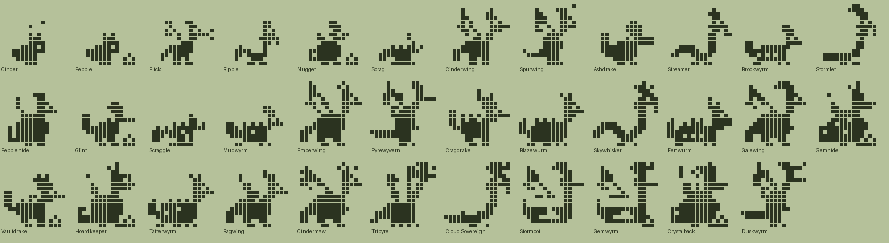
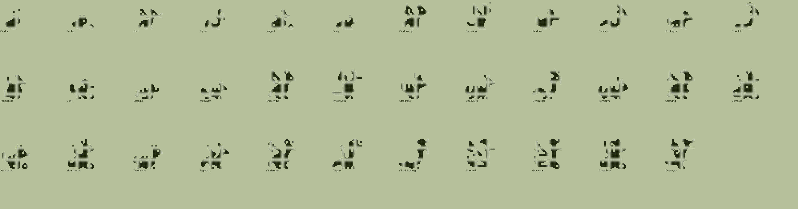

# Dragon family (Plus): design

Status: design only. Species data, tree and pixel art exist and validate (`tools/families/dragon.py`, `tools/archetypes_dragon.py`, `python3 tools/check_family.py dragon`). Not wired into the app. All names and art are original (generic folklore terms: wyvern, drake, lindwurm, wyrmling).

## Concept and tone
Friendly all-ages dragons: hiccuping hatchlings grow into western, eastern and wyvern dragons, drakes and lindwurms, and finally into legends. Same engine and care rules as dinos and foxes; only names, art and food labels change.

| Engine food | Dino | Dragon |
|---|---|---|
| meat | Meat | Fire-roast |
| veggie | Veggies | Herbs |
| pasta | Pasta | Gems |

## Lines (Technicolor body colour)
- **Ember** (Fire-roast, `#C0663E`): winged western dragons, wyverns, armoured drakes. Flick, Cinderwing, Spurwing, Ashdrake, Emberwing, Pyrewyvern, Cragdrake, Blazewurm, Cindermaw, Tripyre.
- **Tide** (Herbs, `#5E9A98`): eastern serpents, lindwurms, storm wings. Ripple, Streamer, Brookwyrm, Stormlet, Skywhisker, Fenwurm, Galewing, Cloud Sovereign, Stormcoil.
- **Hoard** (Gems, `#B09A58`): round, upright, treasure-minded. Nugget, Pebblehide, Glint, Gemhide, Vaultdrake, Hoardkeeper, Gemwyrm, Crystalback.
- **Stray** (neglect, `#8C8A6E`): scruffy lizard-like, tattered. Scrag, Scraggle, Mudwyrm, Tatterwyrm, Ragwing, Duskwyrm.
- **Wyrmling** (babies, `#E3D2A8`): Cinder, Pebble.

## Numbers
35 species: 2 wyrmlings, 4 children, 10 teens, 12 adults, 7 ultimates. Requirements use dino and fox magnitudes (mist_min 1/4, train 3, wins 2/5, smarts 12/20/40, heavy, lead); `disc` is not used. Neglect is reached only by `mist_min` (1 at the wyrmling stage, 4 later).

## The tree
Generated from the data.

### Wyrmlings
| Species | Line | Look | Becomes (first match wins) |
|---|---|---|---|
| Cinder | baby | A hatchling that hiccups tiny sparks. | Scrag (1+ care mistakes); Flick (mostly fire-roast); Ripple (mostly herbs); Nugget (mostly gems) |
| Pebble | baby | Sleeps on a heap of shiny stones. | Scrag (1+ care mistakes); Nugget (mostly gems); Ripple (mostly herbs); Flick (mostly fire-roast) |

### Children
| Species | Line | Look | Becomes (first match wins) |
|---|---|---|---|
| Flick | ember | Flaps before it can fly and sneezes flame. | Scraggle (4+ care mistakes); Ashdrake (heavy); Cinderwing (3+ trainings); Spurwing (default) |
| Ripple | tide | A river wyrmling that swims through the air. | Scraggle (4+ care mistakes); Brookwyrm (heavy); Stormlet (12+ smarts); Streamer (default) |
| Nugget | hoard | Round and proud of its tiny hoard. | Scraggle (4+ care mistakes); Pebblehide (heavy); Glint (default) |
| Scrag | stray | A scruffy lizard that nobody combed. | Mudwyrm (3+ trainings); Scraggle (default) |

### Teens
| Species | Line | Look | Becomes (first match wins) |
|---|---|---|---|
| Cinderwing | ember | Big new wings, not yet steady in the air. | Ragwing (4+ care mistakes); Emberwing (default) |
| Spurwing | ember | Two-legged and wing-armed, ever hungry. | Ragwing (4+ care mistakes); Pyrewyvern (default) |
| Ashdrake | ember | Sooty, stocky and slow to anger. | Ragwing (4+ care mistakes); Cragdrake (2+ battle wins); Blazewurm (default) |
| Streamer | tide | A ribbon of a dragon, riding the breeze. | Tatterwyrm (4+ care mistakes); Skywhisker (default) |
| Brookwyrm | tide | Low and long, loves a muddy bank. | Tatterwyrm (4+ care mistakes); Fenwurm (default) |
| Stormlet | tide | Trails a small grumbling raincloud. | Tatterwyrm (4+ care mistakes); Galewing (20+ smarts); Skywhisker (default) |
| Pebblehide | hoard | Heavy as a boulder and twice as stubborn. | Ragwing (4+ care mistakes); Gemhide (default) |
| Glint | hoard | Quick little drake who collects shiny things. | Tatterwyrm (4+ care mistakes); Hoardkeeper (20+ smarts); Vaultdrake (default) |
| Scraggle | stray | All ribs and elbows, rummages for scraps. | Tatterwyrm (3+ trainings); Ragwing (default) |
| Mudwyrm | stray | Dragged through every ditch in the valley. | Tatterwyrm (default) |

### Adults
| Species | Line | Look | Becomes (first match wins) |
|---|---|---|---|
| Emberwing | ember | The classic: glowing wings and a long neck. | Tripyre (5+ battle wins); Cindermaw (default) |
| Pyrewyvern | ember | A wyvern that glides above the bonfires. | Cindermaw (5+ battle wins); Tripyre (default) |
| Cragdrake | ember | Armoured plates, wins by sitting still. | Tripyre (5+ battle wins); Crystalback (default) |
| Blazewurm | ember | A lindwurm that breathes along the ground. | Tripyre (default) |
| Skywhisker | tide | An eastern dragon in graceful loops. | Cloud Sovereign (40+ smarts); Stormcoil (default) |
| Fenwurm | tide | Slow lindwurm of the reed beds. | Stormcoil (default) |
| Galewing | tide | Wide wings that call the wind. | Cloud Sovereign (40+ smarts); Stormcoil (default) |
| Gemhide | hoard | Crusted with jewels, glitters when it growls. | Crystalback (default) |
| Vaultdrake | hoard | Guards the vault door and counts coins. | Gemwyrm (40+ smarts); Crystalback (default) |
| Hoardkeeper | hoard | Spectacled bookkeeper of the treasury. | Gemwyrm (default) |
| Tatterwyrm | stray | Dented lindwurm with a chewed ear. | Duskwyrm (default) |
| Ragwing | stray | Tattered wings, still gets airborne. | Duskwyrm (default) |

### Ultimates
| Species | Line | Look | Becomes (first match wins) |
|---|---|---|---|
| Cindermaw | ember | Wings of embers and a tail on fire. | (final form) |
| Tripyre | ember | Three heads, three small bonfires. | (final form) |
| Cloud Sovereign | tide | Emperor of the sky, with a pearl and a crown. | (final form) |
| Stormcoil | tide | Coiled thunderhead, crackling with sparks. | (final form) |
| Gemwyrm | hoard | Ancient coil wrapped round a mountain of gems. | (final form) |
| Crystalback | hoard | A spine of crystal spikes and a floating orb. | (final form) |
| Duskwyrm | stray | A hollow-eyed wyvern with a pale halo. | (final form) |

## Art direction
- **Dragon read:** a horned head with a snout, a long tail, then one of several body plans, so species differ by silhouette, not decoration:
  - `dr_west` / `dr_westwide` / `dr_westlow`: winged quadruped, long neck, spade tail (wings up, wide, or folded and low-necked).
  - `dr_wyv`: biped wyvern, big wing-arms, barbed tail, tiny forelimb.
  - `dr_east` / `dr_eastlong`: wingless S-curved serpent with whiskers and mane (the long one stretches along the ground).
  - `dr_wurm` / `dr_wurmup`: low lindwurm, two forelegs, belly drag.
  - `dr_drake`: small wingless quadruped, frill spines, curled tail.
  - `dr_hoard` / `dr_hoardfat`: round upright dragon with small wing.
  - `dr_hydra`: three necks and heads. `dr_coil`: coiled around a hoard with a raised head and wings.
  - `dr_stray`: spindly, low lizard. `dr_hatch`: wyrmling with big head and horn nubs.
- All are built natively at each stage size (0.62, 0.7, 0.86, 1, 1).
- **New decorations** (`EXTRA_HANDLERS`): `dr_flame`, `dr_embers`, `dr_whisk`, `dr_pearl`, `dr_gems`, `dr_frill`, `dr_ridge`, `dr_scars`, `dr_cloud`, `dr_orb`, `dr_belly`. Reused: crown, halo, glasses, bolt, spots, plates/spikes/fur back, flame tail.

## Weak spots
- At 16x16 the winged dragons (Emberwing, Galewing, Cindermaw, Cinderwing) are close cousins; they differ mainly by wing size, neck and decoration.
- Wings are large and the horn pair can read as rabbit ears on the small teen sizes (Cinderwing, Flick).
- Eastern dragons (Ripple, Streamer, Skywhisker) are thin 2 px curves; Ripple at child size reads as a bird or seahorse.
- Lindwurms (Brookwyrm, Fenwurm, Tatterwyrm, Blazewurm) are similar low bodies; ridge, scars and head height separate them.
- Tripyre's three heads clump at the top; Stormcoil and Gemwyrm share the coil body (crown and bolt/cloud differ).
- Stray bodies (Scrag, Scraggle) are cluttered lumps in plain ink; the fur texture is noisy.
- Several decorations (`dr_embers`, `dr_orb`, `dr_cloud`) are 4 to 6 loose pixels.

## Integration notes (app must learn)
1. Load `tools/families/dragon.py` like fox. It imports `archetypes_dragon`, which registers archetypes and decorations at import time.
2. Food labels Fire-roast/Herbs/Gems; line colours from `LINE_COLORS`.
3. The Swift/TS generators must emit `dr_*` decoration names, or bake rows for the sprite renderer.
4. Family picker, Plus gating and Dex counts as for fox.

## Open questions
- Should Duskwyrm (halo plus scars) be a stray ultimate or too gloomy for 12+ tone? It is meant as a gentle ghost.
- Tripyre (hydra) is a folklore term; fine, but confirm.
