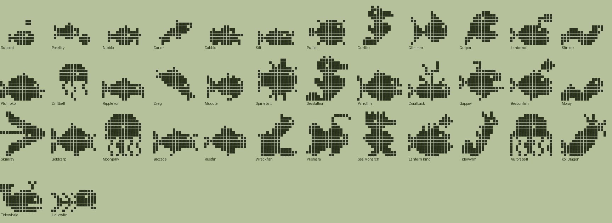
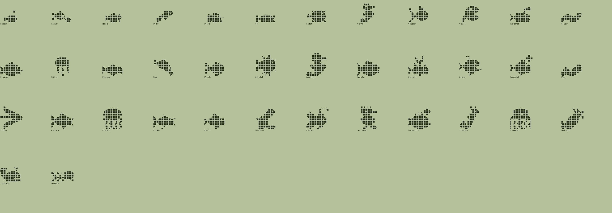

# Fish family (Plus): design

Status: design only. Data, evolution tree and art exist and validate (`tools/families/fish.py`, `tools/archetypes_fish.py`, `python3 tools/check_family.py fish`). Not wired into the app. Names and art are original (generic aquatic animals and folklore only).

## Concept and tone
Aquatic pets in a bowl-sized world: guppies, puffers, seahorses, rays, jellies, eels, anglers, koi and whales, growing toward a koi dragon, a lantern angler king and a rainbow reef spirit. Gentle, bubbly, all-ages. Same care rules as the other families.

| Engine food | Dino | Fish label |
|---|---|---|
| meat | Meat | Shrimp |
| veggie | Veggies | Algae |
| pasta | Pasta | Plankton |

## Lines (Technicolor body colour, `LINE_COLORS`)
- **Reef** (algae): coral `#E08A5C`. Puffers, seahorses, colourful fancy fish.
- **Deep** (shrimp): deep blue `#3F5F8A`. Anglers with lanterns, eels, rays, serpent.
- **Pond** (plankton): koi gold `#E3A04B`. Koi, carp, jellies, the whale.
- **Stray** (neglect): murky `#8E8F78`. Silt, Dreg, Muddle, Rustfin, Wreckfish, Hollowfin.
- **Baby**: pale `#BFD7DC`.

## Numbers
38 species: 2 hatchlings, 4 children, 11 teens, 13 adults, 8 ultimates. Requirement magnitudes match the fox and dino trees (mist_min 1/4, train 3, wins 5, smarts 12/40, heavy, lead). Hatchlings: mist_min=1 goes to Silt (stray); each food lead has a branch. Every teen has a mist_min=4 exit to Rustfin. Ordinary care never reaches the stray line.

## The tree
### Hatchlings
| Species | Line | Look | Becomes (first match wins) |
|---|---|---|---|
| Bubblet | baby | Hatched inside a bubble and still wearing a bit of it. | Silt (1+ care mistakes); Darter (mostly shrimp); Nibble (mostly algae); Dabble (mostly plankton) |
| Pearlfry | baby | A tiny fry that found one big shiny pearl. | Silt (1+ care mistakes); Dabble (mostly plankton); Nibble (mostly algae); Darter (mostly shrimp) |

### Children
| Species | Line | Look | Becomes (first match wins) |
|---|---|---|---|
| Nibble | reef | Grazes on every green thing in the tank. | Muddle (4+ care mistakes); Pufflet (heavy); Curlfin (12+ smarts); Glimmer (default) |
| Darter | deep | Zips after shrimp and never sits still. | Muddle (4+ care mistakes); Gulper (heavy); Lanternet (12+ smarts); Slinker (default) |
| Dabble | pond | A pond baby that loves to splash. | Muddle (4+ care mistakes); Plumpkoi (heavy); Driftbell (12+ smarts); Ripplekoi (default) |
| Silt | stray | Tank-bottom dweller, murky and shy. | Dreg (3+ trainings); Muddle (default) |

### Teens
| Species | Line | Look | Becomes (first match wins) |
|---|---|---|---|
| Pufflet | reef | Puffs up round whenever it is surprised. | Rustfin (4+ care mistakes); Spineball (default) |
| Curlfin | reef | A young seahorse, curious and curly-tailed. | Rustfin (4+ care mistakes); Seastallion (default) |
| Glimmer | reef | Scales that flash every colour of the reef. | Rustfin (4+ care mistakes); Parrotfin (3+ trainings); Coralback (default) |
| Gulper | deep | Mostly mouth and always hungry. | Rustfin (4+ care mistakes); Gapjaw (default) |
| Lanternet | deep | Carries a little lamp into the dark. | Rustfin (4+ care mistakes); Beaconfish (default) |
| Slinker | deep | Slips through cracks in the rocks. | Rustfin (4+ care mistakes); Skimray (3+ trainings); Moray (default) |
| Plumpkoi | pond | Round, orange and very well fed. | Rustfin (4+ care mistakes); Goldcarp (default) |
| Driftbell | pond | A soft little jelly that drifts with the tide. | Rustfin (4+ care mistakes); Moonjelly (default) |
| Ripplekoi | pond | Whiskered and calm, glides through the pond without a ripple. | Rustfin (4+ care mistakes); Brocade (3+ trainings); Goldcarp (default) |
| Dreg | stray | Rummages in the gravel for leftovers. | Wreckfish (default) |
| Muddle | stray | Cloudy water suits it just fine. | Wreckfish (3+ trainings); Rustfin (default) |

### Adults
| Species | Line | Look | Becomes (first match wins) |
|---|---|---|---|
| Spineball | reef | A great spiky puffer, round as a drum. | Prismara (5+ battle wins); Tidewhale (default) |
| Seastallion | reef | Proud seahorse with a tall crest. | Sea Monarch (40+ smarts); Prismara (default) |
| Parrotfin | reef | Bright and bold with a bony beak. | Prismara (default) |
| Coralback | reef | Wears a living garden of coral. | Sea Monarch (40+ smarts); Prismara (default) |
| Gapjaw | deep | Grins wide enough to swallow the moon. | Tidewyrm (5+ battle wins); Lantern King (default) |
| Beaconfish | deep | Its lamp guides lost fish home. | Lantern King (default) |
| Moray | deep | Long and sly, peeks out of every hole. | Tidewyrm (default) |
| Skimray | deep | Glides along the sea floor like a kite. | Aurorabell (40+ smarts); Tidewyrm (default) |
| Goldcarp | pond | Slow, golden and wonderfully wise. | Koi Dragon (40+ smarts); Tidewhale (default) |
| Moonjelly | pond | Glows softly like a paper lantern. | Aurorabell (default) |
| Brocade | pond | Patterned like a silk robe. | Koi Dragon (default) |
| Rustfin | stray | Patchy and worn, but still swimming. | Hollowfin (default) |
| Wreckfish | stray | Lives in a sunken boot and calls it home. | Hollowfin (default) |

### Ultimates
| Species | Line | Look | Becomes (first match wins) |
|---|---|---|---|
| Prismara | reef | The rainbow spirit of the reef. | (final form) |
| Sea Monarch | reef | Crowned seahorse who rules the kelp. | (final form) |
| Lantern King | deep | The angler king, with a lamp like a star. | (final form) |
| Tidewyrm | deep | A gentle sea serpent with horns and a sail. | (final form) |
| Aurorabell | deep | A jelly bright as the northern lights. | (final form) |
| Koi Dragon | pond | A koi that climbed the waterfall and became a dragon. | (final form) |
| Tidewhale | pond | A great whale singing the tides in and out. | (final form) |
| Hollowfin | stray | A ghostly fish skeleton drifting by moonlight. | (final form) |

## Art direction
- **Silhouette:** every fish is side-on and facing right (the ray is seen from above), read from its own body plus a round eye hole. Seahorses have a snout, crest and curled tail (Curlfin, Seastallion, Sea Monarch with a crown and a forward curl); the ray has swept wings with notched trailing edges and a long tail; the eels have a head with open jaws, dorsal spines and fins (Slinker, Moray) and the serpent Tidewyrm rears up out of its humps with horns and a neck sail; puffers are round and spiked; jellies are a bell over wavy tentacles; anglers carry a stalked lure (a star lamp on the adults and the king) and a toothy mouth; the whale has flukes, a flat belly and a spout; koi have fan tails and whiskers; Hollowfin is a fish skeleton.
- **One body per species:** since the polish pass there are no shared archetypes with decorations. `tools/archetypes_fish.py` draws every species by hand with a small toolkit (ellipses, polygons, brush strokes, ASCII art blocks), registers it as `fish_<id>`, and sizes it for its stage (babies ~10 px, children ~12, teens ~14, adults and ultimates up to 16).
- **Eye rule:** the eye is the only enclosed hole in a sprite (the builder fills every other pocket) and is moved to the nearest cell with ink on all four sides if a drawing leaves it uncovered, so the Technicolor eye shader (one isolated 1-px hole high on the sprite) always fires. The blink frame fills that one pixel and nothing else.
- **Resting on the ground line:** every sprite touches row 15 (gravel-like fins, curled tail, tentacles, flat belly, boot sole), as before.
- **Reactions:** `tools/reactions.py` maps each `fish_<id>` to its reaction kind (fry, fishy, koi, puffer, seahorse, angler, eel, jelly, ray, whale).

## Floating later
The app can lift the sprite in a water scene: draw the pebble row as a separate "floor" layer (everything on row 15 that is not connected to the body above row 14 is floor), then offset the body 2-4 px upward with a slow sine bob and spawn bubbles; seahorse, jelly, ray and whale can float with no floor layer at all. A "tank" background with the ground line as gravel would keep the current layout working.

## Polish pass
Addressed after the first art pass: Skimray now reads as a ray (swept wings, long tail); the eels (Slinker, Moray, Tidewyrm) have heads, jaws, spines and fins and different silhouettes; Nibble, Darter, Dabble and Silt differ in pose and shape (sprig-nibbler, tilted arrow, round-tailed baby koi, flat whiskered catfish); teens and adults each have their own body; Pearlfry's pearl is large; the Koi Dragon rises up a waterfall with horns and whiskers separated; lanterns and spouts are part of each body. Remaining weak spots: Dreg (a nose-down bottom feeder) is the least distinct of the strays, and Wreckfish's boot is a simple L.

## Integration notes
- `tools/families/fish.py` imports `archetypes_fish` to register the archetypes; the generators that read family modules must import it by name (as `check_family`/`sheet_family` already do). Species recipes carry no decorations any more, so ports only need the baked rows.
- Technicolor: body colour from `LINE_COLORS`; optional layers: pale belly, fin tint, lantern glow.
- Plus gating via `IS_FREE = False`.

## Open questions
- Is a pond/plankton whale acceptable, or should whales be their own "open water" line?
- Should the app float the sprite (see above) before the family ships?
- Is 38 species too many for a first release?
