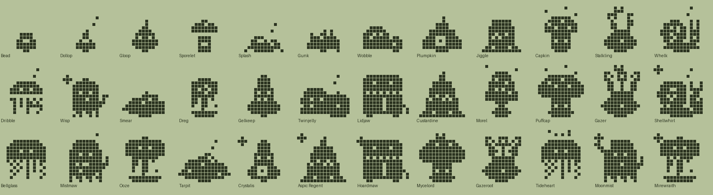
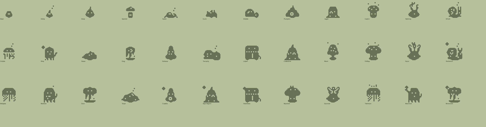

# Slime family (Plus): design

Status: design only. Data, tree and pixel art validate (`tools/families/slime.py`, `tools/archetypes_slime.py`, `python3 tools/check_family.py slime`). Not wired into the app. All names and art are original.

## Concept and tone
Jellies, gel blobs, mushrooms, puddles, goo ghosts, mimics and gelatin desserts. Friendly, squishy, all-ages.

| Engine food | Dino | Slime |
|---|---|---|
| meat | Meat | Jam |
| veggie | Veggies | Moss |
| pasta | Pasta | Dew |

## Lines (Technicolor body colour)
- **Gel** (Jam, `#C8546E`): drops, towers, twins, puddings, mimics, ending in Crystalis, Aspic Regent, Hoardmaw.
- **Spore** (Moss, `#8FA25A`): mushrooms and eyestalk blobs, ending in Mycelord, Gazeroot.
- **Tide** (Dew, `#5FA0B0`): puddles, shells, bell jellies, goo ghosts, ending in Tideheart, Moonmist.
- **Stray** (neglect, `#8A8878`): grey lumps and melting sludge: Gunk, Smear, Dreg, Ooze, Tarpit, Mirewraith.
- **Baby** (`#E3D9A8`): Bead, Dollop.

## Numbers
36 species: 2 babies, 4 children, 10 teens, 12 adults, 8 ultimates. Dino/fox/cat magnitudes; `disc` unused. Neglect by `mist_min` (1 at baby, 4 later).

## The tree
### Babies
| Species | Line | Look | Becomes (first match wins) |
|---|---|---|---|
| Bead | baby | A tiny round drop that jiggles when happy. | Gunk (1+ care mistakes); Gloop (mostly Jam); Sporelet (mostly Moss); Splash (mostly Dew) |
| Dollop | baby | A little swirl with a curl on top. | Gunk (1+ care mistakes); Splash (mostly Dew); Sporelet (mostly Moss); Gloop (mostly Jam) |

### Children
| Species | Line | Look | Becomes (first match wins) |
|---|---|---|---|
| Gloop | gel | Sticky, shiny and ready to bounce. | Smear (4+ care mistakes); Plumpkin (heavy); Wobble (3+ trainings); Jiggle (default) |
| Sporelet | spore | Grew a tiny cap overnight. | Smear (4+ care mistakes); Stalkling (12+ smarts); Capkin (default) |
| Splash | tide | A puddle that giggles when stepped round. | Smear (4+ care mistakes); Whelk (heavy); Wisp (12+ smarts); Dribble (default) |
| Gunk | stray | Grey, lumpy and a little bit grumpy. | Smear (3+ trainings); Dreg (default) |

### Teens
| Species | Line | Look | Becomes (first match wins) |
|---|---|---|---|
| Wobble | gel | Split in two and cannot decide which half is in charge. | Ooze (4+ care mistakes); Twinjelly (3+ battle wins); Gelkeep (default) |
| Plumpkin | gel | Round, heavy, with a glowing seed inside. | Ooze (4+ care mistakes); Lidjaw (3+ battle wins); Gelkeep (default) |
| Jiggle | gel | A wobbly pudding that shakes at loud noises. | Ooze (4+ care mistakes); Custardine (default) |
| Capkin | spore | Spotted cap, soft stem, sleepy eyes. | Ooze (4+ care mistakes); Morel (20+ smarts); Puffcap (default) |
| Stalkling | spore | Two eyestalks that look in different directions. | Ooze (4+ care mistakes); Gazer (20+ smarts); Morel (default) |
| Whelk | tide | Carries a swirled shell and moves very slowly. | Ooze (4+ care mistakes); Shellwhirl (default) |
| Dribble | tide | A small bell of jelly trailing little strands. | Ooze (4+ care mistakes); Bellglass (default) |
| Wisp | tide | A ghost made of goo. Drifts through keyholes. | Ooze (4+ care mistakes); Mistmaw (default) |
| Smear | stray | Leaves a trail wherever it goes. | Tarpit (3+ trainings); Ooze (default) |
| Dreg | stray | Melting from the top, still smiling. | Tarpit (default) |

### Adults
| Species | Line | Look | Becomes (first match wins) |
|---|---|---|---|
| Gelkeep | gel | A tower of clear gel with layers like a trifle. | Aspic Regent (5+ battle wins); Crystalis (default) |
| Twinjelly | gel | Two halves, one heart, endless bickering. | Aspic Regent (5+ battle wins); Hoardmaw (default) |
| Lidjaw | gel | A chest that is not a chest. It has teeth. | Hoardmaw (default) |
| Custardine | gel | A caramel pudding with a cherry on top. | Crystalis (40+ smarts); Aspic Regent (default) |
| Morel | spore | Tall, pitted cap. Knows every damp corner. | Gazeroot (40+ smarts); Mycelord (default) |
| Puffcap | spore | A great round cap that bursts into spores. | Mycelord (default) |
| Gazer | spore | Three eyestalks and no secrets left. | Gazeroot (default) |
| Shellwhirl | tide | A big spiral shell humming with the sea. | Tideheart (default) |
| Bellglass | tide | A drifting bell of glass-clear jelly. | Moonmist (40+ smarts); Tideheart (default) |
| Mistmaw | tide | A hungry fog ghost with a toothy grin. | Moonmist (default) |
| Ooze | stray | Slumps, drips and carries on regardless. | Mirewraith (default) |
| Tarpit | stray | A wide black puddle that mutters to itself. | Mirewraith (default) |

### Ultimates
| Species | Line | Look | Becomes (first match wins) |
|---|---|---|---|
| Crystalis | gel | A faceted tower of gel with a star-bright core. | (final form) |
| Aspic Regent | gel | Crowned lord of the dessert table. | (final form) |
| Hoardmaw | gel | Guards a treasure that is also its stomach. | (final form) |
| Mycelord | spore | Mossy monarch of the forest floor. | (final form) |
| Gazeroot | spore | An ancient watcher with a halo of spores. | (final form) |
| Tideheart | tide | The sea inside a jelly, glowing softly. | (final form) |
| Moonmist | tide | A moonlit ghost of goo, calm and silver. | (final form) |
| Mirewraith | stray | The bog itself, risen and looking for company. | (final form) |

## Art direction
Blobs are told apart by silhouette, built natively per stage (0.66/0.74/0.86/1/1): `slime_drop`/`slime_blob` (peaked drop), `slime_tall` (three tiers), `slime_twin`/`twin2` (split in two), `slime_cap`/`capfat` (mushroom), `slime_morel` (pitted cone cap), `slime_stalk`/`stalk3` (eyestalks), `slime_shell` (snail shell), `slime_jelly`/`bell` (dome with strands), `slime_ghost` (scalloped skirt, wisp), `slime_gel` (flan on a plate), `slime_mimic` (chest with teeth), `slime_lump`/`lump2` (sludge), `slime_melt`/`melt2` (drips), `slime_puddle`, plus baby `slime_bead`, `slime_dollop`. Inner patterns are carved: core, layers, pits, shell spiral. New decorations: slime_shine, bubbles, core, layer, cherry, dots, spores, moss, drip, crack, tongue, spark, moon, fangs, lumps.

## Weak spots
- Eyes are single carved pixels; blink fills only the main eye on multi-eye bodies (a wink).
- Wobble/Twinjelly, Smear/Tarpit and Dreg/Ooze/Mirewraith are the closest pairs in plain ink; size and decoration separate them.
- The four cap bodies (Sporelet, Capkin, Puffcap, Mycelord) share the mushroom idea; Morel is the most distinct.
- Floating bubble and spore dots are single islands and may read as noise on a real LCD.
- Lidjaw and Hoardmaw are the same chest; Hoardmaw only adds a spark.

## Integration notes
Load like cat; `archetypes_slime` registers archetypes and `slime_*` decorations at import. Generators must emit the new decoration names. Food labels Jam/Moss/Dew; colours from `LINE_COLORS`.

## Open questions
Should mimic and ghost bodies sit in the gel/tide lines? Is a Plus family of 36 too many blobs?
