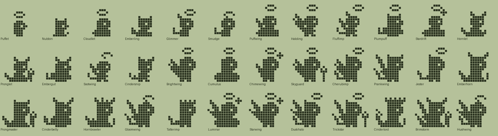
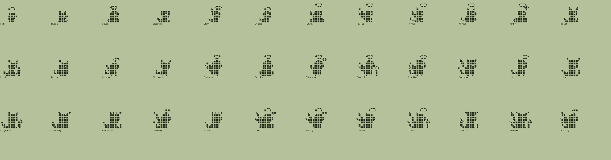

# Halos and Horns (Plus): design

Status: design only. Species data, evolution tree and pixel art exist and validate (`tools/families/spirits.py`, `tools/archetypes_spirits.py`, `python3 tools/check_family.py spirits`). It is **not wired into the app yet**; see "Integration". Names and art are original, built from parts (ellipses, triangles, lines).

## Concept and tone
Small round spirits with a halo, little horns, wings and a pointed tail. **Alignment is the whole point:** how you treat the pet decides whether it grows into a shining angel, a cheeky little devil or a mischievous cherub-imp. The tone is lighthearted and non-religious: cartoon creatures, a tiny toy trident instead of a pitchfork, ember and cloud bases on the ground line. The devil line is playful and cute, never scary, and every branch is a pleasant one.

## The alignment scheme (existing engine signals only)
| You do... | Signal | The pet grows toward |
|---|---|---|
| Care consistently and **scold it when it is naughty** (the "behaves" action, +25 discipline each) | `disc` 25 / 50 / 75 with `mist_max` 1 | **Angels** (Haloling, Brightwing, Luminar, Starwing) |
| Care well but never scold (disc stays 0) | default branches, diet decides | In-between or **playful devil**, by food: Clouds lean cherub, Embers lean imp |
| Spoil it: overfeed (`heavy`) and never scold | `heavy`, no `disc` | **Devils** (Plumpuff, Embergut, Cinderbelly, Cinderlord) |
| Train and battle with Embers | `train`, `wins`, `lead` meat | **Devils** (Pronglet, Prongmaster, Hornbrawler, Brimstorm) |
| Mix: a scolded devil, or a never-scolded cherub | `disc` 25 or 50 flips a line | **Cherub-imps** (Fluffimp, Cherubimp, Duskhalo, Trickstar) |
| Neglect it (4+ mistakes in a stage) | `mist_min` | The **sooty line** (Sootwing, Gloomwing, Hushwing): cute and wistful, still reachable to redeem |

Key points:
- **Discipline is the lever.** It is cumulative (0 to 100, never decays). One scold (25) already turns an Emberling or Cloudlet one step toward the light; 50 reaches Brightwing from the imp line; 75 (three scolds) unlocks Luminar. A player who never scolds simply gets the devil/imp side, which is pleasant, not a punishment.
- **Ordinary care is safe.** Feeding when hungry, cleaning and a few visits a day gives 0 to 1 mistakes and lands on Puffwing/Cumulus/Hornlet/Emberhorn and then Duskhalo or Cinderlord. Naughty calls expire without a mistake, so ignoring them never hurts, it only forgoes discipline.
- **Both extremes are reachable on purpose.** Luminar: Clouds, scold three times, keep mistakes low. Cinderlord: Embers, never scold, spoil or train. Redemption works both ways: a sooty pet that gets scolded 2+ times climbs to the imp line, and a sooty teen or adult with wins can become a Brimstorm.
- Neglect line is reached only by `mist_min` 4 (2 for hatchlings, as the brief's ranges allow), same as the dino and fox thresholds.

## Foods
| Engine food | Dino label | Spirit label |
|---|---|---|
| meat | Meat | Embers |
| veggie | Veggies | Clouds |
| pasta | Pasta | Stardust |

## Lines (they decide the body colour in Technicolor)
- **Halo** (Clouds, scolded): soft gold `#E8D9A0`. Cloudlet, Puffwing, Haloling, Stardrift, Brightwing, Cumulus, Chimewing, Skyguard, Luminar, Starwing.
- **Imp** (mixed): lilac `#A98FB8`. Glimmer, Fluffimp, Plumpuff, Cherubimp, Prankwing, Jester, Duskhalo, Trickstar.
- **Horn** (Embers, spoiled): warm brick `#C0583E`. Emberling, Hornlet, Pronglet, Embergut, Emberhorn, Prongmaster, Cinderbelly, Hornbrawler, Cinderlord, Brimstorm.
- **Soot** (neglect): smoky grey `#78727C`. Smudge, Sootwing, Cindersnip, Gloomwing, Tatterimp, Hushwing.
- **Hatchlings:** cream `#F0E6D2`.

## Numbers
36 species: 2 hatchlings, 4 children, 10 teens, 13 adults, 7 ultimates. Every species is reachable, every list ends in a fallback, no branch is shadowed (`tools/check_family.py`, which tests `disc` at 0/25/50/75). Requirement magnitudes follow the dino and fox trees (`mist_min` 4, `train` 3, `wins` 3 to 5, `smarts` 12/20/40) plus `disc` 25/50/75.

## The tree
### Hatchlings
| Species | Line | Look | Becomes (first match wins) |
|---|---|---|---|
| Puffet | baby | A fluffy hatchling with a tiny floating halo. | Smudge (2+ care mistakes); Cloudlet (mostly Clouds); Emberling (mostly Embers); Glimmer (mostly Stardust) |
| Nubbin | baby | A warm hatchling with two little horn buds. | Smudge (2+ care mistakes); Emberling (mostly Embers); Glimmer (mostly Stardust); Cloudlet (mostly Clouds) |

### Children
| Species | Line | Look | Becomes (first match wins) |
|---|---|---|---|
| Cloudlet | halo | Naps on its own little cloud. | Sootwing (4+ care mistakes); Haloling (25+ discipline, at most 1 care mistakes); Plumpuff (heavy); Stardrift (12+ smarts); Puffwing (default) |
| Emberling | horn | Toasty, giggly and a bit of a rascal. | Sootwing (4+ care mistakes); Fluffimp (25+ discipline, at most 1 care mistakes); Embergut (heavy); Pronglet (3+ trainings); Hornlet (default) |
| Glimmer | imp | Halo on one side, horn on the other. | Sootwing (4+ care mistakes); Haloling (50+ discipline, at most 1 care mistakes); Plumpuff (heavy); Stardrift (12+ smarts); Fluffimp (default) |
| Smudge | soot | Sooty and sleepy, with a wonky halo. | Fluffimp (50+ discipline, at most 3 care mistakes); Cindersnip (3+ trainings); Sootwing (default) |

### Teens
| Species | Line | Look | Becomes (first match wins) |
|---|---|---|---|
| Puffwing | halo | Soft little wings, a cloud for a pillow. | Gloomwing (4+ care mistakes); Chimewing (20+ smarts); Skyguard (3+ battle wins); Cumulus (default) |
| Haloling | halo | Polite, shiny and a tiny bit proud. | Gloomwing (4+ care mistakes); Skyguard (3+ battle wins); Chimewing (20+ smarts); Brightwing (default) |
| Fluffimp | imp | Cherub wings, imp horns, double the mischief. | Tatterimp (4+ care mistakes); Brightwing (50+ discipline, at most 1 care mistakes); Jester (20+ smarts); Cherubimp (default) |
| Plumpuff | imp | Very well fed and very well loved. | Tatterimp (4+ care mistakes); Cumulus (25+ discipline, at most 1 care mistakes); Cinderbelly (default) |
| Stardrift | halo | Collects stardust and secrets. | Tatterimp (4+ care mistakes); Chimewing (25+ discipline, at most 1 care mistakes); Jester (default) |
| Hornlet | horn | Little horns, big plans. | Tatterimp (4+ care mistakes); Cherubimp (25+ discipline, at most 1 care mistakes); Hornbrawler (3+ battle wins); Emberhorn (default) |
| Pronglet | horn | Practises with a tiny trident toy. | Tatterimp (4+ care mistakes); Cherubimp (25+ discipline, at most 1 care mistakes); Hornbrawler (3+ battle wins); Prongmaster (default) |
| Embergut | horn | Round, warm and always snacking. | Tatterimp (4+ care mistakes); Prankwing (25+ discipline, at most 1 care mistakes); Cinderbelly (default) |
| Sootwing | soot | Smudgy wings and a crooked halo. | Prankwing (50+ discipline, at most 3 care mistakes); Gloomwing (3+ trainings); Tatterimp (default) |
| Cindersnip | soot | A scruffy little ember that sneaks about. | Prankwing (50+ discipline, at most 3 care mistakes); Tatterimp (3+ trainings); Gloomwing (default) |

### Adults
| Species | Line | Look | Becomes (first match wins) |
|---|---|---|---|
| Brightwing | halo | A graceful flyer with a steady glow. | Starwing (40+ smarts); Luminar (default) |
| Cumulus | halo | A big soft cloud with a halo on top. | Luminar (75+ discipline); Duskhalo (default) |
| Chimewing | halo | Rings like a bell and knows every song. | Starwing (default) |
| Skyguard | halo | Cheerful champion of the high clouds. | Luminar (75+ discipline); Starwing (40+ smarts); Duskhalo (default) |
| Cherubimp | imp | Halo, horns and a grin; nobody is sure which wins. | Luminar (75+ discipline); Duskhalo (default) |
| Prankwing | imp | Pointed tail, bat wings, harmless pranks. | Duskhalo (50+ discipline); Trickstar (default) |
| Jester | imp | Clever and cheeky, in glasses. | Trickstar (default) |
| Emberhorn | horn | Grand curled horns and a warm heart. | Duskhalo (25+ discipline); Cinderlord (default) |
| Prongmaster | horn | Spins its tiny trident like a pro. | Brimstorm (5+ battle wins); Cinderlord (default) |
| Cinderbelly | horn | Big, jolly and happily spoiled. | Trickstar (50+ discipline); Cinderlord (default) |
| Hornbrawler | horn | Headbutts for fun, never for keeps. | Brimstorm (default) |
| Gloomwing | soot | Tattered bat wings and a shy smile. | Duskhalo (75+ discipline); Hushwing (default) |
| Tatterimp | soot | Patched-up imp who never gives up. | Duskhalo (75+ discipline); Brimstorm (5+ battle wins); Hushwing (default) |

### Ultimates
| Species | Line | Look | Becomes (first match wins) |
|---|---|---|---|
| Luminar | halo | The shining one: a big halo and wide white wings. | (final form) |
| Starwing | halo | Trails stardust across the night sky. | (final form) |
| Duskhalo | imp | Half angel, half imp, wholly lovable. | (final form) |
| Trickstar | imp | Master of harmless tricks and tiny tridents. | (final form) |
| Cinderlord | horn | A crowned imp king with a flame-tipped tail. | (final form) |
| Brimstorm | horn | Bat wings, big horns and a bigger laugh. | (final form) |
| Hushwing | soot | Quiet, soft and sooty, with a faint warm halo. | (final form) |

## Art direction
- **Silhouette first.** Plain ink must read by: a **floating halo ring** (5x3, one row clear of the head), **small wings** (swept up behind the shoulder, or a short folded wedge), **little horns** (connected diagonal bands, 3 to 7 pixels, never single dots), a **spade tail** along the ground, and a **base on the ground line**: round feet, cloud puffs or ember flames. Every feature is at least 2 px.
- **Bodies** (`tools/archetypes_spirits.py`): `spr_feet` (cherub), `spr_imp` (spade tail), `spr_cloud`, `spr_ember`/`spr_emberb`, the broad adult versions `spr_big*`, and `spr_chub*` for the well-fed. All are a big round head on a small body, built **natively per stage**, with small stages chunkier (width grows as `k^-0.7`) so hatchlings are mostly head.
- **Alignment reads in the decorations:** halo only = angel; halo plus one horn (halo pushed aside) = cherub-imp; horns only = devil; crooked, gapped halo plus bat wings = sooty line; crown and flame tail only on Cinderlord.
- **New decorations** (all `spirits_` prefixed, in `EXTRA_HANDLERS`): `halo`, `halo_small` (alias), `halo_side`, `halo_crook`, `nubs`, `horns`, `horn1`, `bighorns`, `wings`, `bigwings`, `wingfold`, `batwings`, `trident`, `sparkles`. Existing ones reused: `glasses`, `crown`, `fur` and `spikes` via back, flame via tail.
- **Technicolor** (to build): body colours by line as above; proposed accents: halo and sparkles `#F6E27A`, horns and trident `#7A3B2E`, wings white-cream `#F4EFE4` on the halo line and dark plum on the imp and soot lines, ember base orange `#E58A3A`, cloud base `#F4EFE4`. Tune by eye.

## Sensitivity and App Store review
- **No religious figures, text, rites or symbols.** The halo, horns, wings and tail are generic cartoon features used in countless children's games and emoji. Nothing is named after a scripture, an order of beings or a deity: no "seraph", "archangel", "demon", "Satan", "hell" or similar words appear in names, blurbs or copy. Use "spirit", "imp", "halo" and "horns" only.
- **Nothing mocks a faith or its believers.** The devil line is not evil: it is the playful, spoiled, rascal side (embers, a toy trident, pranks) and is never punished or shamed. The angel line is not holy: it is the polite, shiny, well-behaved side. Neither is presented as good or bad people; the choice is "how you play".
- **Never moralise.** The app must not say "bad pet" or "sinner". Use light copy ("Emberhorn is feeling mischievous") and the same cheerful animations for all lines. No fire, blood, torment or scary imagery; embers are small orange flames on the ground.
- **Age rating.** Fine for the planned 12+ listing with no Frequent/Intense mature themes and no references to religion beyond cartoon fantasy. Avoid the words "heaven" and "hell" in store text, screenshots and metadata, and avoid screenshots that pair the two lines as "good vs evil". Describe the family as "angel, imp and cherub-style spirits" with "a playful side and a polite side".
- **Disclose the mechanic gently.** A short Dex tooltip ("scolding a naughty pet teaches manners") keeps the discipline lever from feeling hidden without nagging.
- If review ever asks, the answer is: fantasy creatures with generic costume features, no real-world religion depicted.

## Later feature: an alignment meter on the stats page
Add one page to the stats pager (after DISC) with a horizontal **halo-to-horns meter**: a small halo icon at the left, a small horn icon at the right, and a marker. A simple score the app can compute from live state, no new engine signals: `alignment = discipline - 12 * careMistakes (this stage and last) - (heavy ? 15 : 0)`, clamped to -50..+100, mapped so high is the halo end, low is the horn end, and the middle is the "mischievous" band. Show it only for this family (or colour it by line for all families). Tapping it can show what to try: "Scolding naughty moments shifts it toward the halo; treats and spoiling shift it toward the horns." Both ends should look inviting, not like a score to maximise. The dex can show which lines each ultimate came from.

## Known weak spots in the art
- At 16x16 the round heads are close in outline to a cat head: the horns are the only separation, so devils and imps lean on horn shape (diagonal bands) and the spade tail. Judge them in Technicolor before redrawing.
- The ember flames and cloud puffs are only a few pixels, and the ember base reads as a rough lump in plain ink; the cloud base reads well.
- The up-swept wings are blocky wedges. They read as wings but lack feather detail; bat wings differ from feather wings only by a scalloped lower edge.
- Hatchlings and children are small and chunky, with the halo larger than the head; fine in play but the weakest silhouettes.
- Several neighbouring adults share a body and differ only in decorations (Brightwing/Skyguard, Emberhorn/Hornbrawler).
- Sparkles on Stardrift, Chimewing, Luminar and Starwing read as stray pixels in plain ink.

## Integration (the next step, not done)
1. Generators read this module like the fox: species, `LINE_COLORS`, hatchlings, `FOOD_LABELS`.
2. **The app must learn nothing new for evolution:** `disc` is already supported in `Shared/Species.swift` and `expo-prototype/src/core/pet.ts`. Only confirm the family checker's disc coverage and the balance run per family.
3. Register the new decorations in the sprite renderer (list above), and the `halo_side` / `halo_crook` variants.
4. Per-family food labels in the feed menu; the "choose your egg" screen with Plus gating.
5. Technicolor lines and accent colours (halo, horns, cloud, ember base).
6. Optional: the alignment meter page above. Discipline never decays; consider whether a family-wide daily decay of a few points would make alignment feel more like ongoing treatment (this needs an engine change and is not assumed).
7. Tests: the family check, a balance run, a render of every species, and the Traditional-mode regression.

## Open questions for the owner
- **Name.** "Halos and Horns" kept; alternatives: "Mischief and Light", "Cloud and Ember".
- **Discipline pacing.** Naughty calls are occasional, so 75 discipline (three scolds) is a deliberate achievement. Should Luminar need only 50?
- **Un-scolded Ember pets.** They end as Cinderlord (a crowned, cute imp king). Is that the right default for a never-scold player, or should it be the in-between Duskhalo?
- **Neglect line tone.** Sooty and wistful rather than devilish; confirm you do not want neglect to lead to the most devil-like forms instead.
